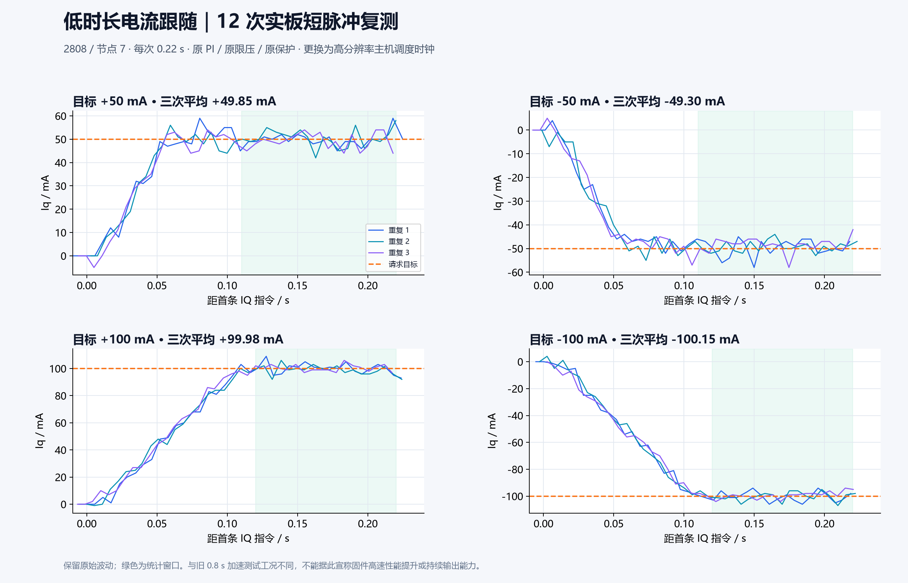
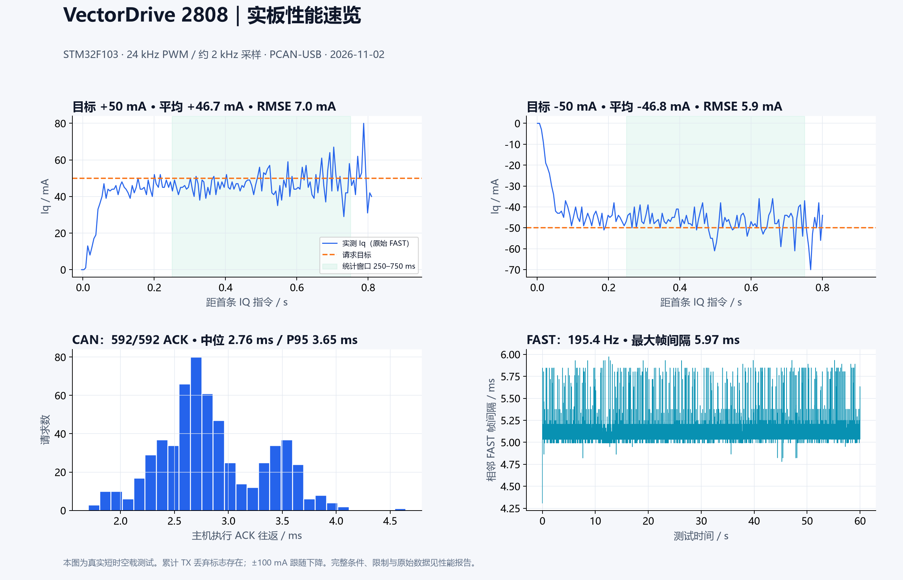
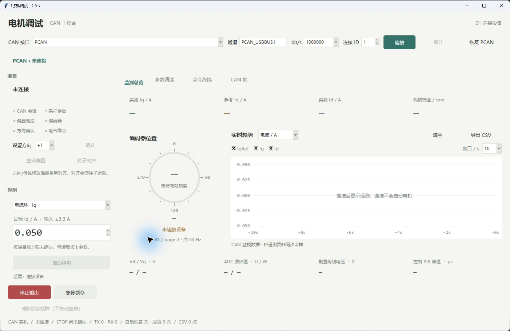
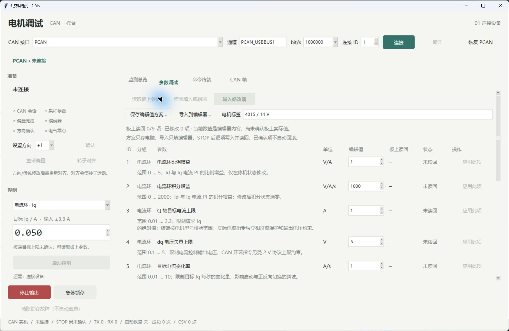
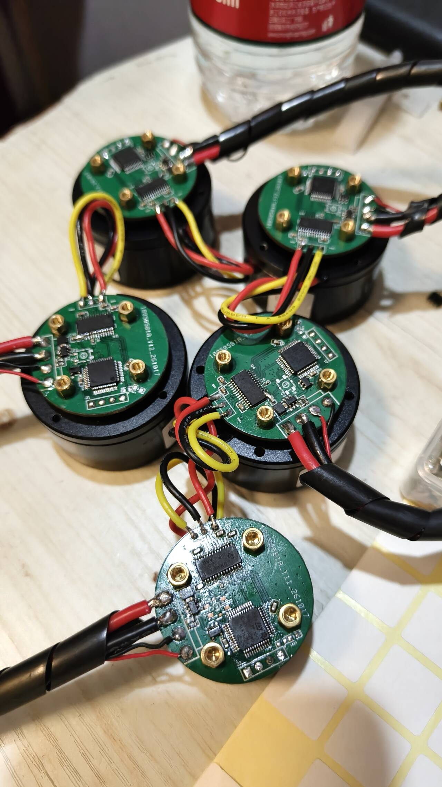
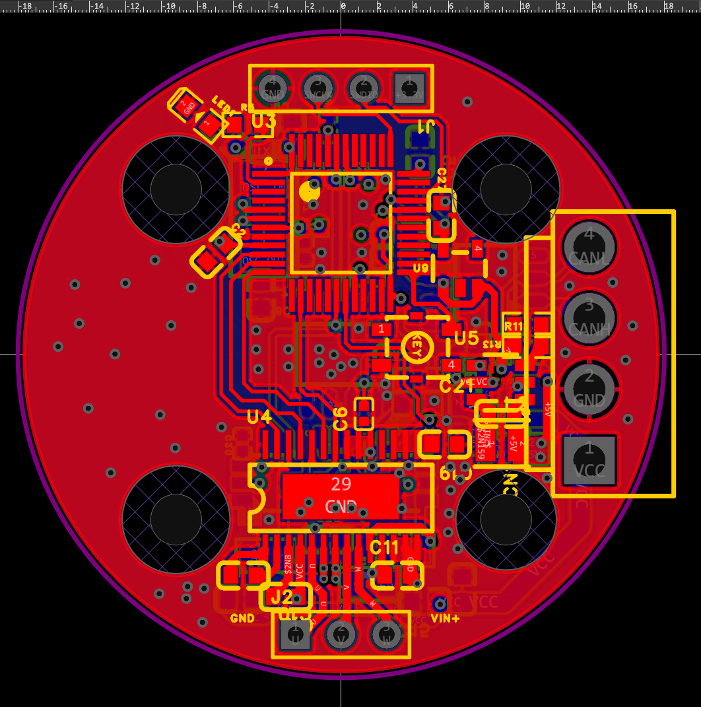
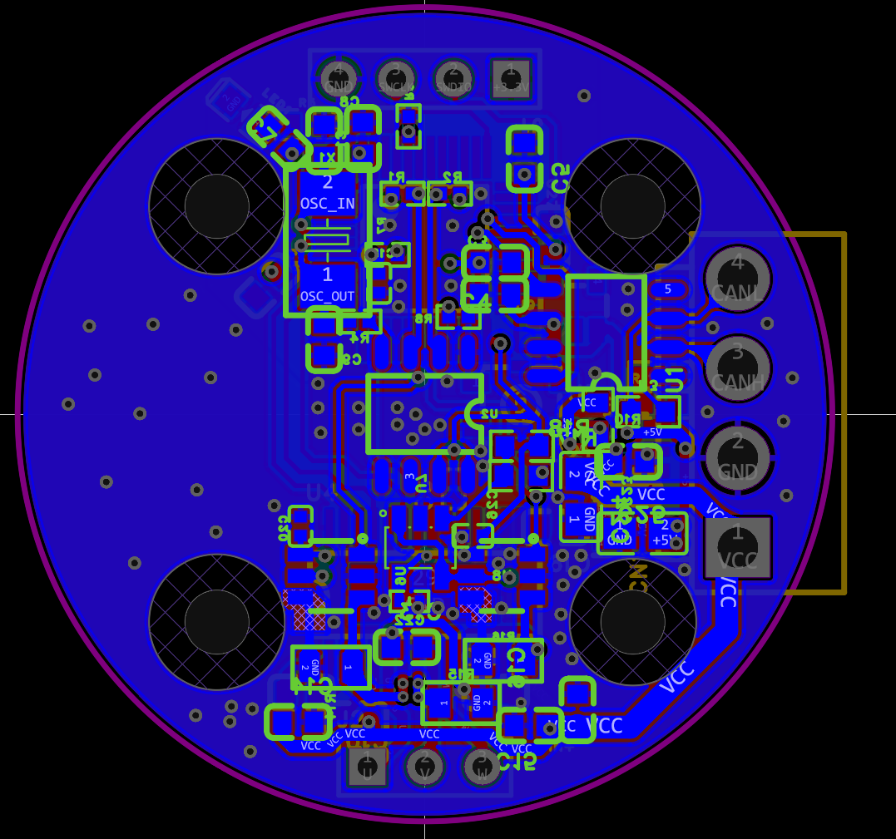
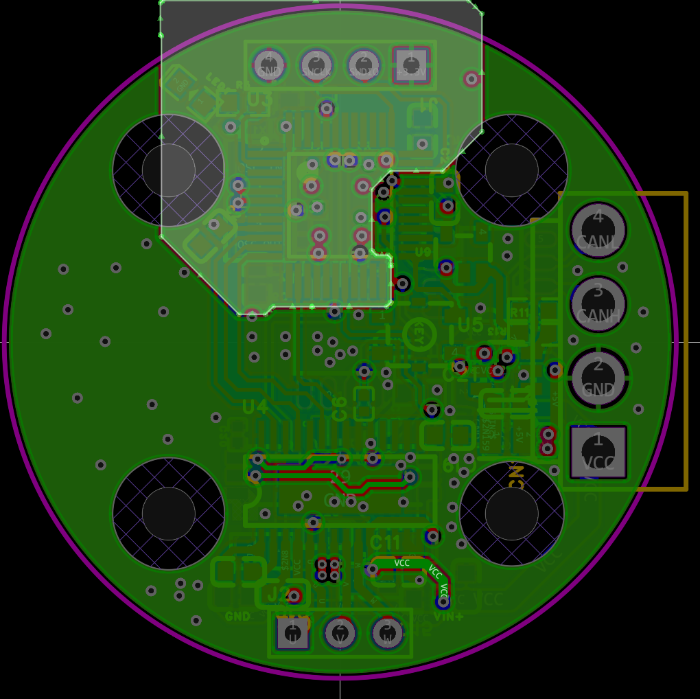
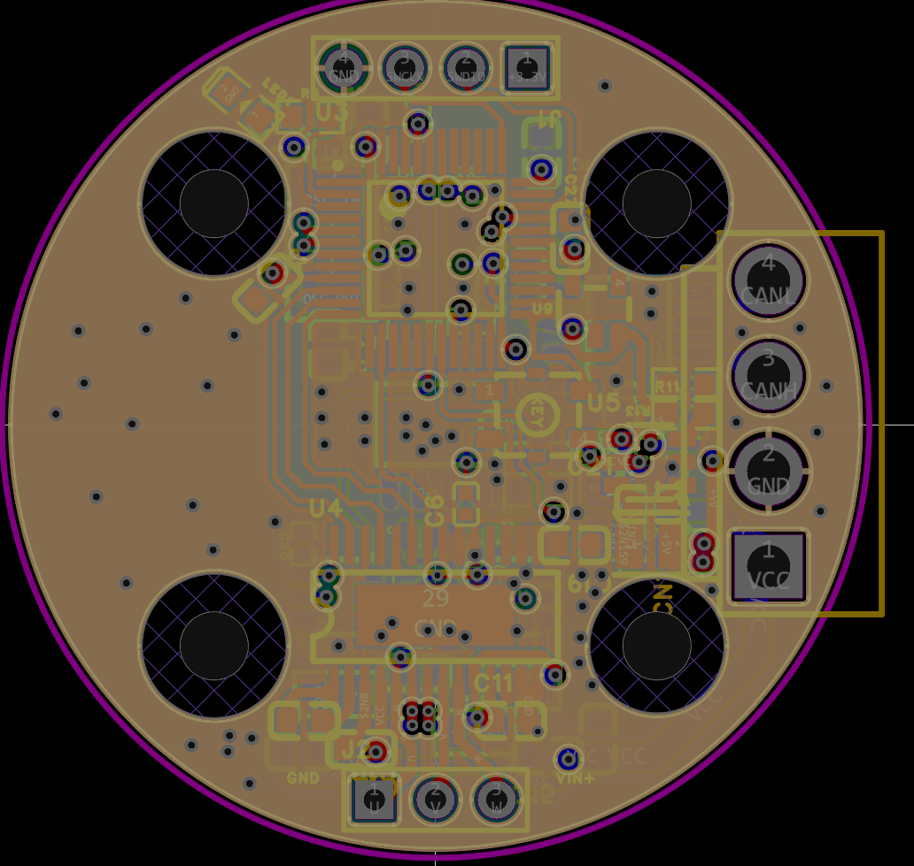
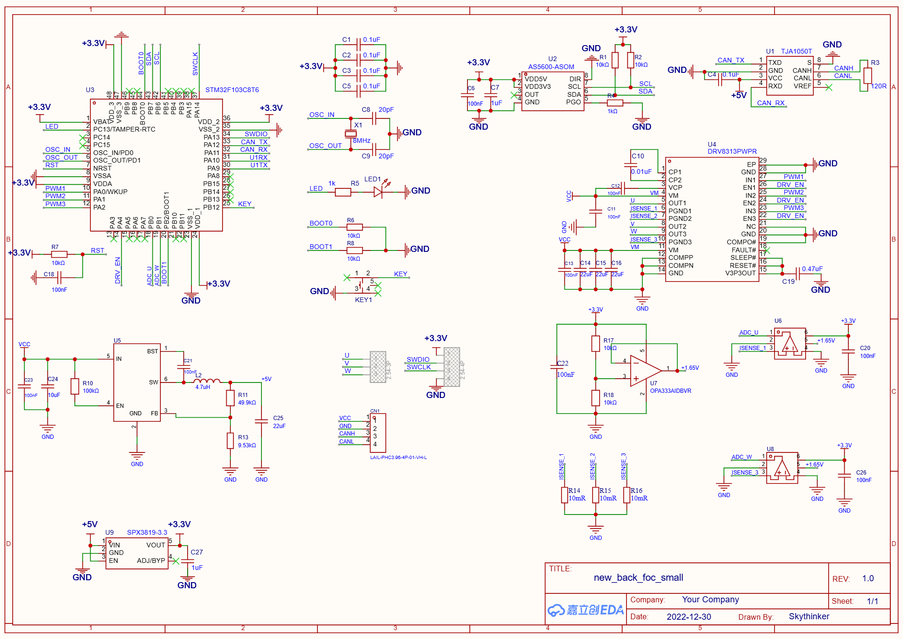

# VectorDrive 2808 · 矢驱 2808

**从四层驱动板到电流闭环、CAN 协议和中文上位机的完整 FOC 项目。** 基于 STM32F103C8T6、DRV8313、AS5600 与双路低侧电流采样，公开硬件工程、固件、Windows 上位机源码和可复核的实板测试记录。

[**下载 Windows 上位机与固件**](https://github.com/Gary-KU/vectordrive-2808/releases/latest) · [**实板性能报告**](docs/PERFORMANCE_20261102.md) · [上位机说明](docs/CAN_WORKBENCH.md) · [CAN 协议](docs/CAN_PROTOCOL.md) · [固件构建](FIRMWARE_GUIDE.md)

## 最新排查：短脉冲跟随与调度修复

原固件 / 原 PI / 原保护不变，12 次 0.22 s 短脉冲复测中，±100 mA 平均反馈为 **+99.98 / −100.15 mA**。同时修复 Windows 粗时钟问题，指令发送间隔中位从约 **16.3 ms 降至 10.2～10.5 ms**；上位机现在明确提示转速报文超量程。



[排查结论、时钟对照与原始证据](docs/CURRENT_DIAGNOSIS_20261102.md)。本次缩短了测试时长，未证明高速/持续带载性能提升；旧 0.8 s 加速测试的限压问题仍需进一步验证。

<details>
<summary>展开首次测试性能总览</summary>



</details>

[电流跟随全图](docs/images/performance-20261102/current-tracking.png) · [CAN 延迟与反馈周期](docs/images/performance-20261102/can-performance.png) · [断流停机曲线](docs/images/performance-20261102/timeout-stop.png)

## 首次测试基线

2026-11-02，2808 / 7 极对 / 节点 7，DAPLink + PCAN-USB 实板测试：

| 指标 | 本次结果 |
|---|---:|
| CAN 请求成功执行 ACK | **592 / 592**，60 秒测试 |
| 主机请求往返延迟 | **2.76 ms 中位 / 3.65 ms P95** |
| 快速机械角度 / 速度 / Iq 反馈 | **195.4 Hz** |
| 同步 ADC 采样 | **约 2 kHz** |
| PWM 载波 | **24 kHz**，寄存器配置核对 |
| ±50 mA 短时电流平均反馈 | **+46.7 / −46.8 mA** |
| 停止续发目标后观察到驱动关闭 | **约 105.8 ms** |
| 软件回归 | **212 项 Python 测试全部通过，C 回归通过** |

**测试边界：** 单板、空载、短时结果；累计 TX 丢弃标志存在，严格通信验收未通过，不能宣称零丢包。±100 mA 空载加速时跟随下降，速度报文出现量程饱和。尚未验证连续大电流、带载转矩、效率或温升。3.3 A 是协议请求范围，实际能力不能据此推定。[查看条件、误差和原始证据 →](docs/PERFORMANCE_20261102.md)

## 软硬件都在这里

| 内容 | 入口 | 已有功能 |
|---|---|---|
| 四层驱动板 | [嘉立创 EDA 工程](hardware/new_back_foc_small.epro2) | MP2359 Buck、DRV8313、U/W 双路 INA181A2 + 10 mΩ 采样 |
| STM32 固件 | [software/](software/) | CMSIS 寄存器驱动、SVPWM、d/q 电流 PI、速度外环、保护联锁 |
| 中文上位机 | [desktop/](desktop/) / [Windows 下载](https://github.com/Gary-KU/vectordrive-2808/releases/latest) | 电流/速度/开环指令、角度表盘、实时曲线、参数读写、CSV、CAN 日志 |
| CAN 控制与示例 | [协议](docs/CAN_PROTOCOL.md) / [examples/](examples/) | 1 Mbps、节点 1..63、执行 ACK、100 ms 运动期限、约 200 Hz FAST 目标 |
| 掉电存储 | [节点与电零点说明](docs/CAN_PROTOCOL.md#节点-id-的修改与掉电保存) | 节点 ID 与电角度零点独立 CRC 日志；普通 PI 参数保留在 RAM |
| 测试与证据 | [tests/](tests/) / [实测报告](docs/PERFORMANCE_20261102.md) | 主机回归、正反向小电流、断流停机、CAN 时延和运行时序 |

电流环在板内按 2 kHz 执行，速度外环配置为 1 kHz；PC 通过 CAN 更新目标，不参与每拍 PI 运算。速度外环已有软件植物模型回归，**本次没有完成实板速度整定**。固件可选择 2808 / 7 极对与 4015 / 11 极对，本页性能数值仅对应 2808。

## 中文上位机界面

最新版 Windows 程序的真实窗口截图，展示连接设置、控制区、机械角度表盘、趋势曲线与参数编辑器。截图时保持未连接，参数编辑值不代表实板读回结果。



<details>
<summary>展开参数调试界面</summary>



</details>

[下载 Windows 上位机](https://github.com/Gary-KU/vectordrive-2808/releases/latest) · [完整使用说明](docs/CAN_WORKBENCH.md)

## 快速开始

### Windows 上位机

1. 在 [Releases](https://github.com/Gary-KU/vectordrive-2808/releases/latest) 下载 `GimbalCAN-Studio-Windows-x64.zip`，完整解压后运行 EXE。
2. PCAN-USB 安装 PEAK 驱动；连接 CAN_H、CAN_L、GND，总线两端各 120 Ω。
3. 选择 PCAN / PCAN_USBBUS1 / 1 Mbps；连接 ID 填板上实际节点，**本次实测板为 7，新板默认 1**。
4. 连接后先检查停机、故障、编码器与校准状态；从小电流开始，结束点击 STOP。

程序启动保持未连接，编辑目标不会自动启动电机。模拟器需要手动选择，其数据不能作为实板证据。完整操作见 [上位机使用说明](docs/CAN_WORKBENCH.md)。

### 从源码运行上位机

使用带 Tcl/Tk 的 Python 3.12，在仓库根目录运行：

```powershell
python -m venv .venv-can
.\.venv-can\Scripts\python.exe -m pip install -r desktop/requirements.txt
.\.venv-can\Scripts\python.exe -m desktop
```

### 构建固件与运行回归

安装 ARM GNU 工具链；主机 C 测试还需要原生 GCC：

```powershell
.\build.ps1 -Configuration Release -Motor 2808 -Test
.\.venv-can\Scripts\python.exe -m unittest discover -s tests
```

Keil 入口为 [GimbalFOC.uvprojx](software/MDK-ARM/GimbalFOC.uvprojx)。GCC 输出位于 `software/build/Release/`。预编译 HEX/BIN 与构建信息也放在 Release 下载中；烧录前核对电机型号、极对数和保护配置，避免全片擦除覆盖已保存节点或校准。详见 [固件指南](FIRMWARE_GUIDE.md)、[调参指南](docs/TUNING_GUIDE.md) 与 [电机选型配置](docs/MOTOR_SELECTION.md)。

## 硬件与个人工作

参考遥想星空的设计，完成原理图调整、PCB 大范围重新布局、部分芯片替换、固件实现与板卡焊接。当前代码公开了板级驱动、FOC 控制、应用状态机、CAN 协议与中文上位机；具体结构见 [工程地图](docs/PROJECT_STRUCTURE.md)。

- **电源：** 5 V 由 LDO 方案改为 MP2359 Buck，3.3 V 使用 SPX3819-3.3；效率和温升改善幅度尚未实测。
- **电流采样：** INA181A2IDBVT、10 mΩ 双路 U/W 低侧采样，软件重构 V 相并进行 Clarke/Park 变换。
- **布局：** 四层板与参考平面；未宣称已经通过 EMI 或串扰测试。
- **调试：** 历史记录包含 DRV8313 修复、电流采样排查、同步采样时序与编码器 I²C 恢复；本次补充真实 CAN 和正反向电流数据。[电流闭环调试记录](docs/CURRENT_LOOP_BRINGUP.md)

### 实物装配

驱动板与电机的装配实拍。



### PCB 铜层视图

以下为本次提供的四张 PCB 视图，按提供顺序排列；点击图片可查看原图。

| 视图 1 | 视图 2 |
|---|---|
|  |  |
| **视图 3** | **视图 4** |
|  |  |

<details>
<summary>展开原理图预览</summary>



</details>

EDA 工程中保留主图板及历史备份，制造前须确认所选版本。预览图不替代制造检查。

## 来源与许可

本项目参考遥想星空的设计，原工程名为 `new_back_foc_small`，原理图保留 `Skythinker` 绘制者署名；具体上游链接、版本及身份关系仍待核实，继续保留原有归属说明。项目整体及上游硬件许可证尚未确定，公开仓库不额外授予使用许可。固件所含 ARM / ST CMSIS 文件保留原版权及许可，见 [第三方声明](software/NOTICE.md)。
