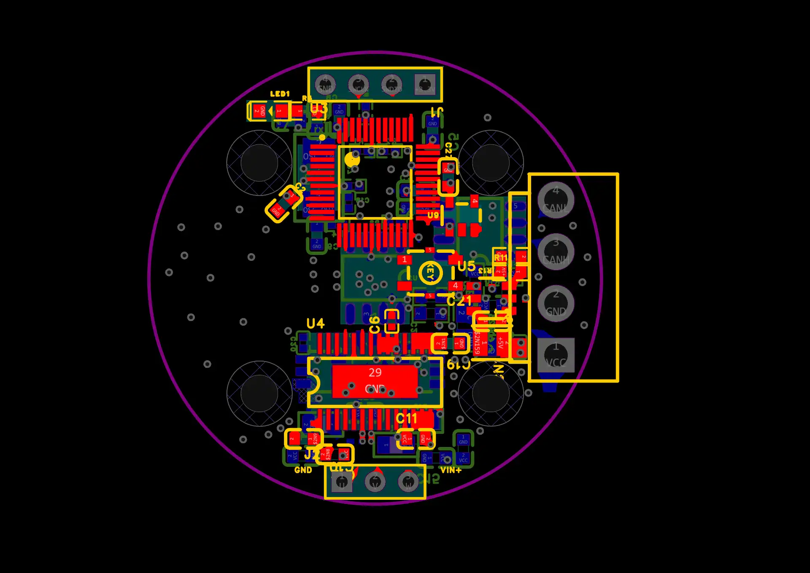
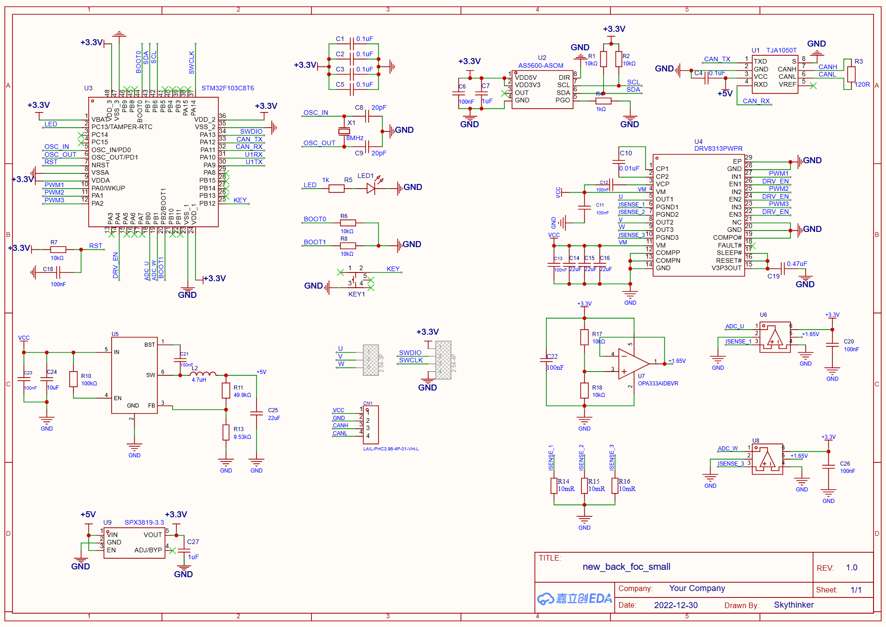

# VectorDrive 2808 · 矢驱 2808

面向 **2808 电机**的紧凑型 FOC 驱动板，支持**电流环与速度环控制**。

VectorDrive 对应矢量控制驱动，2808 标明适配的电机型号。

硬件设计采用嘉立创 EDA 专业版，源工程名称为 `new_back_foc_small`。

## 设计预览

以下图片提取自工程包内置预览。

### 主 PCB

### 原理图

## 工程内容

- `SimpleFOC103` 原理图及关联 PCB `STM32FOC_LCEDA_PCB`
- 独立 PCB `STM32FOC_LCEDA_PCB_1`
- 历史布局备份 `布局前备份_20261015`

## 打开工程

使用嘉立创 EDA 专业版导入 `hardware/` 中的 `.epro2` 工程包。备份图板与主图板在原工程中均予以保留，生产前请确认所选版本。

## 项目状态

本仓库用于发布硬件设计源文件。电气参数、固件配套、制造文件及实测结果尚未整理，不据此声明额定电压、电流或测试通过。

## 来源与许可

源工程名称：`new_back_foc_small`。原理图保留的绘制者字段为 `Skythinker`，原有署名应予以保留。

当前尚未确定项目及其上游设计适用的许可证；仓库公开不等同于授予额外使用许可。明确上游来源及许可后补充 LICENSE 和相应归属说明。
