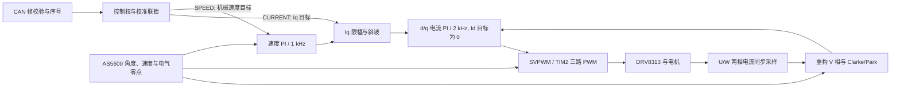

# CAN 电流控制协议

本固件以 CAN 下发 **q 轴电流 Iq** 作为主要控制方式。Iq 单位为 A，决定电磁转矩；它不是母线电流、目标电压或速度。电流模式直接进入 d/q 电流 PI，速度模式另外启用外层速度 PI，再把输出作为 Iq 目标。

当前配置为 STM32F103C8T6、电机可选 2808/7 极对或 4015/11 极对、14 V 母线，24 kHz PWM、2 kHz 同步 ADC/电流环、1 kHz 速度环。DRV8313 修复后已实测验证 U/W 电流映射、极性和真实电流 PI。真正断电上电时，Release 先完成 ADC 偏置；若存在与电机型号、极对数匹配的 Flash 校准，则静默恢复方向和电角零点；否则才用 3 V、4 s 完成一次自动 ALIGN 并返回 STOP。CAN、软件复位或节点 ID 重启不会触发未保存的自动吸合。



## 总线与标识符

Classic CAN 2.0A，标准 11 位数据帧，DLC 必须为 8；不接受扩展帧或 RTR。多字节整数均为小端，负数使用二进制补码。PA11 为 CAN_RX，PA12 为 CAN_TX，板上 TJA1050 接外部总线。默认 1 Mbps；出厂节点 ID 为 1，可通过下述节点配置协议停机修改并掉电保存，无需为每个 ID 重新编译。波特率仍由 `software/Config/can_config.h` 编译配置。

协议位于 `software/Communication/Inc/can_protocol.h` 和 `software/Communication/Src/can_protocol.c`；CAN 外设层位于 `software/BSP/Inc/board_can.h` 和 `software/BSP/Src/board_can.c`。前台协议把已校验目标交给 `App`，电流环与 PWM 采样仍由 ADC ISR 驱动。完整目录职责见 [工程结构说明](PROJECT_STRUCTURE.md)。

`can_service` 负责启动和轮询：CAN 初始化失败时，每隔至少 500 ms 在停止且无待执行命令的条件下重试，成功后丢弃旧会话并要求新的 STOP 执行确认。该恢复不会清故障或启动电机；已初始化外设的 bus-off 保留原自动恢复规则。重试间隔配置为 `CAN_INIT_RETRY_PERIOD_MS`。

| 用途 | 标识符公式 | 默认节点 1 |
|---|---|---|
| 节点命令 | `0x200 + node` | `0x201` |
| 全总线 ESTOP | 固定 | `0x080` |
| 状态反馈 | `0x180 + node` | `0x181` |
| 诊断反馈 | `0x280 + node` | `0x281` |
| 执行 ACK | `0x380 + node` | `0x381` |
| 参数读回 | `0x480 + node` | `0x481` |
| 调参遥测 | `0x580 + node` | `0x581` |
| 电角度校准读回 | `0x640 + node` | `0x641` |
| 节点配置读回 | `0x680 + node` | `0x681` |
| 快速机械反馈 | `0x700 + node` | `0x701` |

节点范围为 1..63。支持 125/250/500 kbps 和 1 Mbps。72 MHz 系统下 APB1 为 36 MHz；默认 1 Mbps 使用 BRP=2、BS1=13 TQ、BS2=4 TQ、SJW=1 TQ，采样点 77.78%。

此协议与参考工程的 `0x100/0x200` 分组电压控制协议不同。硬件精确过滤当前节点命令和广播 ESTOP，软件继续校验 magic、长度、类型和保留字段。

## 节点 ID 的修改与掉电保存

ID 范围 1..63；总线上每块板必须不同。配置时一次只连接一块驱动板。上位机顶部的“连接 ID”只改变主机寻址；真正修改板上 ID 要使用参数页的“板上节点 ID · 掉电保存”。普通九项电流/速度参数仍只保存在 RAM，不能与此功能混淆。

节点命令使用 `0x200 + 当前ID`，帧格式独立于运动命令：

| 命令 | 8 字节数据 |
|---|---|
| `NODE_READ=0x12` | `A1 12 seq 00 00 00 00 00` |
| `NODE_SET=0x13` | `A1 13 seq 新ID 43 41 4E 31`（末四字节为 ASCII `CAN1`） |

两命令均返回标准执行 ACK，再返回 `0x680 + 当前ID`：`[A1, opcode回显, seq, result, active_id, stored_id, 01, flags]`。flags 的 bit0 表示有效持久记录，bit1 表示存储记录异常，bit2 表示已进入维护、随后必复位。`0x86=STORAGE` 表示实际保存失败；`0x87=UNSUPPORTED` 表示当前特殊镜像不支持配置。未写过 ID 时 active/stored 为出厂默认 1，bit0 为 0。

NODE_SET 需要已完成 STOP 握手、驱动关闭、应用无故障且维护门通过。保存前停止采样/PWM，写入校验成功后通过旧 ID 回复，随后软件复位。复位会重采偏置和清除 RAM 调参值；若已有匹配的电角度 Flash 校准则会静默恢复，否则保持零点无效，不自动运动。所有自动开环试验镜像拒绝 NODE_SET。

## 电角度零点的掉电保存

第一次在电机空载、转子可安全移动时完成 DIRECTION/ALIGN，确认 `zero_valid=1` 后再显式保存。固件绝不自动保存对齐结果，避免带载或受机械限位影响时把错误零点永久写入。

| 命令 | 8 字节数据 |
|---|---|
| `CALIBRATION_READ=0x15` | `A1 15 seq 00 00 00 00 00` |
| `CALIBRATION_SAVE=0x16` | `A1 16 seq 00 43 41 4C 31`（ASCII `CAL1`） |
| `CALIBRATION_CLEAR=0x17` | `A1 17 seq 00 43 4C 52 31`（ASCII `CLR1`） |

三者先返回执行 ACK，再返回 `0x640+node`：`[A1, opcode, seq, result, flags, i8 direction, u16 zero_mrad]`。flags bit0=有有效保存值，bit1=存储异常，bit2=保存值与当前固件电机配置不匹配，bit3=本次运行零点有效，bit4=写入完成并即将复位。SAVE/CLEAR 需要 STOP 握手、驱动关闭且维护门通过；SAVE 还要求 ADC 偏置、编码器、方向和本次零点全部有效。成功写入或清除后板子复位，上位机必须重新 STOP 握手并读回确认。

存储位于 `0x0800F000..0x0800F7FF` 两个 1 KiB 追加日志页，记录版本、电机型号、极对数、方向、电角零点、代数、CRC 和最终提交字。节点 ID 使用独立的 `0x0800F800..0x0800FFFF`。CRC 错误或配置不匹配不会回退到自动吸合，而是保持 STOP 并禁止闭环，要求人工读取、清除和重新空载校准。

主机迁移顺序：读取旧配置 → 监听目标 ID 占用 → 只发送一次 SET → 等待旧 ID 的执行/保存读回 → 新 ID STOP 握手 → NODE_READ 确认 active/stored/有效标记。旧应答丢失时可能已经保存，必须探测新地址，不能盲目重发 SET。若保存结果仍未确认，应分别查询旧/新地址；不要清故障或自动发运动来试地址。占用检查只覆盖在线节点，不能替代单板配置。

存储区为 64 KiB STM32F103C8 的最后两页：`0x0800F800..0x0800FFFF`，程序链接区缩为 62 KiB。采用双页追加记录、CRC 与最后提交标记；断电时保留最近完整记录，无有效记录时回默认 ID 并报告异常，可在停机单板条件下重新保存修复。已有脏记录却无有效 ID 时，所有运动命令返回 STORAGE，不能直接运动；重新保存并确认后恢复。普通按 HEX 地址范围烧录保留 ID 页；全片擦除会恢复出厂 ID。2808 与 4015 仍分别选择 7／11 极对，ID 不改变电机型号。

命令终端示例：`node` 读取，`node 3 single` 表示明确按单板配置将当前板保存为 ID 3。一块一块设置好左右轮 3／7 后，再接回 MyLegwheel 总线。

## 快速机械反馈与六节点总线

`0x700 + node` 每 5000 µs 最多发布一个最近快照（目标 200 Hz），标准 8 字节：`[A1, flags, angle_u16_le, velocity_i16_le, iq_i16_le]`。机械单圈角度单位 mrad，合法范围 0..6283；速度为机械 mrad/s；Iq 为 mA。flags 与状态帧字节2相同，传感器无效或角度非有限时必须清 sensor_valid，主机不得将零值当作有效零角。FAST 无 mode/故障完整字段，仍需新的状态和诊断确认 CURRENT、驱动使能及无故障。

FAST 与原约 33 Hz 的 trace/page2 并存。它携带最近 App 快照，不带采样时间戳，200 Hz 发布不等于六节点同步采样；CAN 仲裁、前台 I²C 和主机调度都会产生延迟。MyLegwheel 关节使用独立 FAST 新鲜度、原始接收时间配对和机械角分支校准门禁，不能用新收到的其它帧掩盖旧角度。

允许硬件自动仲裁/错误重发，防止正常多节点仲裁失败就丢包；所有待发邮箱仍受有界取消约束：FAST 最长 5 ms，其余帧最长 20 ms，bus-off 立即请求取消全部待发。软件优先刷执行 ACK/参数回复，FAST 与 trace 各保留一个最新值槽，避免三个硬件邮箱塞满时 trace 永久饥饿。过期快照合并/丢弃，不在恢复后补发旧运动或角度。

六节点采用各 100 Hz 电流命令及 ACK、各 100 Hz 状态/诊断/trace、各 200 Hz FAST，共约 4200 帧/s；按标准8字节帧含IFS与最坏填充约135 bit估算，1 Mbps 约56.7%负载，未含额外查询和错误重发。主控内部可更快计算，但总线目标刷新统一 100 Hz，不应无节制提高六路发送频率。

## 命令帧

| 字节 | 含义 |
|---|---|
| 0 | magic/版本，固定 `0xA1` |
| 1 | opcode |
| 2 | 8 位 sequence |
| 3 | 运动命令必须为 `0x01`；其他命令必须为 `0x00` |
| 4..5 | 有符号 16 位目标，小端 |
| 6..7 | 无符号 16 位辅助量，小端；仅 OPEN 使用，其他必须为 0 |

| opcode | 命令 | 字节 4..5 | 字节 6..7 |
|---|---|---|---|
| `0x00` | STOP | 0 | 0 |
| `0x01` | IQ / CURRENT | Iq，mA；2808/4015请求范围均±3300，另受参数3当前读回限制 | 0 |
| `0x02` | SPEED | 机械速度，mrad/s；当前限制 ±30000 | 0 |
| `0x03` | OPEN | 电角速度，0.01 rad/s；范围 ±10000 | q 轴电压，mV；协议上限 2000，独立于闭环 5 V 限值 |
| `0x04` | ALIGN | 0 | 0 |
| `0x05` | CLEAR | 0 | 0 |
| `0x06` | DIRECTION | 编码器方向，只接受 +1 或 -1 | 0 |
| `0x07` | CALIBRATE | 0 | 0 |
| `0x7F` | ESTOP | 0 | 0 |

IQ、SPEED、OPEN、ALIGN 为运动命令。DIRECTION、CALIBRATE 和 CLEAR 可以在要求 STOP 握手的状态下提交，但仍受应用层故障、停止和控制权条件限制。总线电压配置仅由本地串口完成，没有对应 CAN opcode。

STOP 在节点命令 ID 上发送；ESTOP 可在节点命令 ID 或广播 `0x080` 上发送。广播 ID 只允许 ESTOP。

## 顺序、控制权与失联停机

- 主控上电后先只监听，等待 `offset_ready/sensor_valid/direction_confirmed/zero_valid=1`、`faults=0`、`mode=STOP`、驱动关闭。已保存校准时不会吸合；未保存时可能进行约 4 s 自动对齐，过早发送 STOP 会安全取消它。随后发送 STOP 并**等待执行 ACK 为 OK**，才能发送运动命令。
- STOP/ESTOP 会清空接收积压并结束本轮收包处理。不要把 STOP 和启动命令一次批量排队；等待 ACK 后再发下一帧。会话撤销也会丢弃旧 RX 队列，防止旧 STOP 和旧目标重新启动电机。
- 非安全命令的序号相对上一条已接收入队命令必须前进 1..127；允许 `255 → 0` 回绕。重复序号和落后的序号会被拒绝。STOP/ESTOP 不受该序号前进规则限制，但仍必须满足格式和新鲜度检查。
- 收到超过 50 ms 的积压帧会被拒绝；应用执行运动命令前还会再次检查 RX 时间。无效、重复、被拒绝或仅用于查询的帧都不会延长运动期限。
- CAN 运动使用 RX 时间作为期限起点，**100 ms 没有成功执行的新运动目标即停机**。建议电流主控以 100 Hz 发送目标，即使数值不变也必须使用新的 sequence。UART 本地运动另有 2 s 期限。
- LOCAL 与 CAN 运动控制权互斥。已有一个来源运行时，另一个来源的运动或配置请求会得到 CONTROL_OWNED；任意来源的 STOP 都能打断运行。本地 STOP 会撤销 CAN 会话。
- ESTOP 立即关闭驱动并锁存故障。CLEAR 不自动重启，只允许在停止/故障且硬件允许时清故障，并重新开始零电流偏置校准。故障清除后仍需满足方向、电气零点等条件。
- bus-off、RX FIFO/ring 丢帧会撤销 CAN 会话；正在运行或等待运行的 CAN 运动还会触发应用 CAN 故障。总线自动恢复不会自动启动电机。CAN 未连接不会阻止本地串口开环调试。

CAN TX 是非阻塞发送，执行 ACK 仍可能因总线错误、回复过期或队列溢出丢失。**丢失 ACK 后用新的 STOP 序号重新握手**；不要把重复发送相同 sequence 的运动帧当作续命。实际执行结果和当前运行状态需要一起检查。

执行 ACK 和参数响应先进入固定 8 帧高优先级回复队列，先于周期遥测发送。三个硬件发送邮箱暂满时，回复保留到后续 Poll 重试，且回复未刷完时暂停低优先遥测；无阻塞等待。软件回复超过 50 ms、队列溢出或总线恢复时会丢弃，不能把队列当作可靠送达保证。状态、诊断和 trace 允许因拥塞掉帧，ACK 的实际关联结果仍须由主机确认。

会话撤销时，已经提交的旧 STOP 或其他非运动请求可能随后得到真实的 OK 执行 ACK；它表示该请求实际完成，不表示控制会话已经恢复。旧 STOP 不会解锁被撤销的握手。此时检查诊断帧 `require_stop`，重新发送一条新的 STOP 并等待对应 ACK 后再启动。

## 首次调试与校准

1. 真正上电后先不发送命令，等待 `offset_ready/sensor_valid/direction_confirmed/zero_valid=1`。有匹配保存值时在偏置完成后静默恢复；没有时自动吸合对齐并回到 STOP。约 6 秒仍未完成时不得发送电流目标。
2. STOP 握手后，用小电压 OPEN 检查相序、旋转方向及编码器变化。默认示例为电角速度 20 rad/s、0.8 V。未确认电流比例时，开环没有经过安培标定的软件过流保护，应配合电源限流进行首次测试。
3. 停止运动后发送 DIRECTION，目标为经实测确认的 +1 或 -1。需要重新偏置校准时发送 CALIBRATE，等待 `offset_ready=1`。
4. 本板已将 U/W 两路设为 10 mΩ、50 倍、polarity=-1，映射、极性和方向 +1 已实测。不同接线仍需单独核实。首次空载 ALIGN 成功后可用 `CALIBRATION_SAVE` 显式写入；软件复位后会在 ADC 偏置完成时恢复，不产生吸合动作。
5. 自动对齐未完成时，在安全机械状态下完成 STOP 握手，发送 DIRECTION 和 ALIGN，并在约 4 s 校准期间每 50 ms 使用新 sequence 续命。完成后驱动自动停止且 `zero_valid=1`。
6. 确认 `sense_confirmed/offset_ready/sensor_valid/direction_confirmed/zero_valid` 均有效，再发送小幅 IQ，例如 ±50 mA。默认使用 CURRENT 模式；SPEED 是需要时启用的外环。

电流、编码器、数值等故障会使电气零点失效。清故障后等待偏置校准，重新 ALIGN，再进入闭环。CALIBRATE、DIRECTION 或改变母线电压同样会使旧零点失效。

## 报文示例

下表 payload 为连续 16 个十六进制字符；所有帧 DLC=8。每个例子仍须满足前述握手与校准条件。

| 场景 | ID | payload |
|---|---|---|
| STOP，seq=0 | `0x201` | `A100000000000000` |
| Iq=+50 mA，seq=1 | `0x201` | `A101010132000000` |
| Iq=-50 mA，seq=2 | `0x201` | `A1010201CEFF0000` |
| SPEED=+1 rad/s，seq=3 | `0x201` | `A1020301E8030000` |
| OPEN=20 电角 rad/s、0.8 V，seq=1 | `0x201` | `A1030101D0072003` |
| 广播 ESTOP | `0x080` | `A17F000000000000` |

从 CURRENT 切到 SPEED 前先 STOP 并等待 ACK，再用下一条合适的新 sequence 发送 SPEED；表中的速度例子单独展示编码方式。OPEN 的 seq=1 示例用于 STOP seq=0 握手后的新测试会话。

例如，无故障 STOP seq=0 的成功响应为 `0x381 / A100000000000000`。交付配置已确认电流换算，但上电后若未设置方向会拒绝 IQ 并返回 NEED_DIRECTION，未完成 ALIGN 则返回 NEED_ZERO；只有全部前置条件有效才执行电流控制。SENSE_UNKNOWN 用于编译时显式关闭采样确认的其他板卡配置。

上位机辅助脚本见 [examples/gimbal_can.py](../examples/gimbal_can.py)。它只生成可复制的 ID/8 字节以及 `ID#HEX` 文本，并提供反馈解码函数，不连接适配器或发送总线。每次调用显式指定新序号，例如：

```powershell
python -B examples/gimbal_can.py --node 1 --seq 1 iq 0.05
```

输出 `201#A101010132000000`。实际发送仍需自己的 USB-CAN 工具及正确的 STOP 握手/闭环校准；脚本生成成功不表示固件已经执行。安培、机械速度、电角速度和电压输入按最近的协议单位舍入，恰半单位时向远离零方向舍入；非有限数和超出原始物理范围的输入会被拒绝。

### 持续控制主机例程

[examples/run_can_current.py](../examples/run_can_current.py) 使用 python-can 实际收发，接受 ±1 A 内的 Iq（包括 0、±1 mA、±50 mA 等低电流），拒绝 ±1001 mA 及其他越界值；先等待 STOP 执行 ACK，再设置方向/对齐，并每 10 ms 发送新序号 IQ。只有收到当前对齐过程的有效反馈才进入电流模式；超时、故障、反馈丢失或正常退出都会尝试有界 STOP 并等待执行 ACK。最终 STOP ACK 丢失时明确报告 `STOP UNCONFIRMED`，不宣称电机已停止。仅收到适配器发送成功不算握手成功。

安装 python-can 及实际适配器驱动后，把 backend/channel 替换成自己的硬件。例如下面的 PCAN 名称只是使用方式示例，本轮没有接入 PCAN 实测：

```powershell
python examples/run_can_current.py --interface pcan --channel PCAN_USBBUS1 --direction 1 --iq 0.05 --duration 2 --align
```

下一次运行若没有复位、故障、CAL/DIRECTION/BUS 改动，且反馈零点仍有效，可以把 `--align` 换为 `--reuse-alignment`；后者不重发 DIRECTION，要求用户确认现有符号正确，因为协议不能回读方向正负。未指定这两个选项时，脚本不会擅自对齐或开始 IQ。

`gimbal_can.py` 的主机 IQ 编码能力为 ±3.3 A，OPEN 电压仍限制在2 V。编码能力不授予板端输出权限：2808 与 4015 板端请求范围均为±3.3 A，默认参数3均为1 A，独立相过流保护1.5 A保持。桌面Controller在主机±3.3 A编码范围内发送；若已真实读回参数3，则目标超过该读回值时弹出“目标超过已读回的电流限幅 ±N A”并拒绝发送，未读回时由板端执行ACK与RANGE决定；收到执行RANGE时明确报错并STOP。写入不确定或重启会撤销展示缓存。`run_can_current.py` 独立实机例程仍限 ±1 A，并保留握手与停止保护；没有因扩大桌面输入而同步放宽。`config/parameters.json`的参数3以host_max指定主机能力，firmware_max_macro绑定型号请求上限；详细协议与独立保护见[2808请求上限](2808_REQUEST_LIMIT.md)。

## 执行 ACK

| 字节 | 含义 |
|---|---|
| 0 | `0xA1` |
| 1 | 对应请求的 opcode |
| 2 | 对应请求的 sequence |
| 3 | 结果值 |
| 4..7 | 应用故障位，uint32 小端 |

正常已入队请求在 ADC 控制中断实际处理后才返回执行 ACK。内部使用 request tag 关联完成，防止被 STOP 替换的旧请求误报成功；tag 不单独上总线。协议拒绝、BUSY 和 CANCELLED 可以立即返回。ACK 表示请求处理结果；后续故障仍可能关断驱动，必须继续监测反馈。

| 值 | 结果 |
|---|---|
| `0x00` | OK，已处理成功 |
| `0x01` | PENDING，内部入队状态；不能当成执行成功 |
| `0x02` | BUSY，已有请求等待处理 |
| `0x03` | FAULT |
| `0x04` | CALIBRATING，偏置尚未就绪 |
| `0x05` | NEED_STOP，切换前需要停止 |
| `0x06` | SENSE_UNKNOWN，电流换算参数未确认 |
| `0x07` | NEED_DIRECTION |
| `0x08` | NEED_ZERO |
| `0x09` | SENSOR，编码器无效 |
| `0x0A` | RANGE，应用参数越界 |
| `0x0B` | CANCELLED，被停止/撤销打断 |
| `0x0C` | CONTROL_OWNED，另一来源持有控制权 |
| `0x0D` | STALE，应用执行时命令已过期 |
| `0x80` | BAD_FRAME，格式、magic、opcode 或保留字段错误 |
| `0x81` | RANGE，协议参数越界 |
| `0x82` | SEQUENCE，重复或落后序号 |
| `0x83` | STALE，协议收到积压过期帧 |
| `0x84` | REQUIRE_STOP，需要重新 STOP 握手 |
| `0x85` | TRANSPORT，预留协议结果；当前主要通过诊断位报告传输状态 |

## 运行时参数扩展

保留版本 `0xA1` 和旧运动命令格式；新增参数操作也使用节点命令 ID `0x200+node`、标准数据帧和 DLC=8，但第 3 字节为参数 ID，最后 4 字节为 IEEE754 float32 小端。旧固件会拒绝未支持的 opcode，应先更新支持此扩展的固件。

| 字节 | 参数请求含义 |
|---|---|
| 0 | `0xA1` |
| 1 | `0x10` PARAM_READ 或 `0x11` PARAM_WRITE |
| 2 | 新 sequence，沿用全局序号规则 |
| 3 | 参数 ID，1..9 |
| 4..7 | float32 LE；READ 必须为 0，WRITE 为目标值 |

| ID | name | 范围 | 单位 |
|---|---|---|---|
| 1 | current_kp | 0..5 | V/A |
| 2 | current_ki | 0..2000 | V/(A·s) |
| 3 | iq_limit | 0.01..1 | A |
| 4 | voltage_limit | 0.1..5 | V |
| 5 | iq_slew | 0.01..10 | A/s |
| 6 | speed_kp | 0..1 | A/(rad/s) |
| 7 | speed_ki | 0..10 | A/rad |
| 8 | speed_limit | 0.1..30 | rad/s，机械速度 |
| 9 | bus_voltage | 8..30 | V，与原 BUS 命令范围相同 |

参数写入必须为 STOP、EN 关闭且无故障；在运行中会返回 NEED_STOP。参数读取可在运动或故障时执行，任何参数操作都不延长运动命令期限。参数操作不代替运动前的 STOP 执行握手。所有写入由 ADC 控制中断消费应用命令后执行，前台 CAN 解析不直接修改控制器。

增益、限幅和斜坡修改会清空 PI 积分并更新缓存，保留已经真实完成的方向和电气零点；BUS 参数按原 BUS 规则使零点失效，随后必须重新 ALIGN。参数只在 RAM 中生效，复位后恢复编译默认值。没有可写的过流保护参数；Iq 限值还必须小于固件固定相过流阈值，因此某些更低过流阈值的调试镜像可能拒绝表中较高目标。IQ/SPEED/OPEN 也会检查当前运行时限幅；OPEN 的协议电压硬上限仍为 2 V。

参数读取、写入均返回原执行 ACK（`0x380+node`）以及参数响应（`0x480+node`），以 opcode/sequence 和 param_id/sequence 分别关联。ACK 不是参数响应的替代品；只有 result=OK 才能视为成功应用。失败响应对有效参数 ID 尽量返回当前值；无效 ID 返回 0。NaN、Inf、未知参数 ID、非零 READ 值或越界写入会被拒绝，保持原参数不变。

| 字节 | 参数响应含义 |
|---|---|
| 0 | `0xA1` |
| 1 | 参数 ID |
| 2 | 对应请求 sequence |
| 3 | result，沿用 ACK 结果码 |
| 4..7 | float32 LE，执行时读回值；失败时须先检查 result |

例如 seq=10 读取 Kp：`0x201 / A1100A0100000000`；seq=11 写 Kp=1.0：`0x201 / A1110B010000803F`。成功写入的参数回应为 `0x481 / A1010B000000803F`，另有普通执行 ACK `0x381 / A1110B0000000000`。上位机辅助 API 为 `Param`、`PARAMETERS`、`pack_param_read(node, seq, param_id)`、`pack_param_write(node, seq, param_id, value)`；`decode_feedback` 兼容原返回并新增 `parameter` 与 `trace` 类型。

## 周期反馈

默认每 10 ms 尝试发送状态、诊断及一页调参遥测。状态、诊断各为 100 Hz；调参遥测在 0/1/2 三页间轮转，每页约 33.3 Hz。各页来自独立状态快照，不能当作同时刻完整样本；低优先级反馈不会等待总线或占住 FOC，拥塞可能丢失反馈。

调参遥测 `0x580+node`（节点 1 为 `0x581`）：`[A1,page,int16LE,int16LE,int16LE]`。数值溢出会饱和到 int16 范围。

| page | 第 2..3 字节 | 第 4..5 字节 | 第 6..7 字节 |
|---|---|---|---|
| 0 | Id，mA | Iq 参考，mA | Vd，mV |
| 1 | Vq，mV | U 原始 ADC 计数 | W 原始 ADC 计数 |
| 2 | 机械角度，mrad | 启动以来最大 ADC 控制 ISR 时间，µs | 配置的母线电压，mV |

母线电压仍是用户配置值，板上没有母线电压 ADC；trace 不会改变这一点。Id/Iq 只有采样参数和电气校准有效时才适合闭环分析，停止时 FOC 输出字段可清零。

状态帧 `0x181`：

| 字节 | 含义 |
|---|---|
| 0 | `0xA1` |
| 1 | 模式：0 STOP、1 OPEN、2 ALIGN、3 CURRENT、4 SPEED、5 FAULT |
| 2 | 状态位，见下表 |
| 3 | 最近已接收入队的请求 sequence |
| 4..5 | 实测 Iq，int16 mA；电流参数未确认时发 0，此时不能视为有效电流测量 |
| 6..7 | 实测机械速度，int16 mrad/s，超出范围时饱和 |

| 状态位 | 含义 |
|---|---|
| bit 0 | 实际驱动 EN 有效 |
| bit 1 | 电流采样参数已确认 |
| bit 2 | 零电流偏置就绪 |
| bit 3 | 编码器数据有效 |
| bit 4 | 编码器方向已确认 |
| bit 5 | 电气零点有效 |
| bit 6 | 运动命令超时 |
| bit 7 | 当前运动控制来源为 CAN |

诊断帧 `0x281`：

| 字节 | 含义 |
|---|---|
| 0 | `0xA1` |
| 1 | 最近应用执行结果或立即提交失败结果；不包含所有协议拒绝 |
| 2..5 | 应用故障位，uint32 小端 |
| 6 | BSP 故障低 8 位 |
| 7 | 诊断标志，见下表 |

| 诊断位 | 含义 |
|---|---|
| bit 0 | 当前 bus-off |
| bit 1 | 当前 error-passive |
| bit 2 | 曾发生 RX 丢帧，锁存至协议重新初始化 |
| bit 3 | 要求 STOP 握手 |
| bit 4 | 有请求等待执行结果 |
| bit 5 | CAN 外设未初始化成功 |
| bit 6 | 曾有协议 TX 入邮箱失败 |
| bit 7 | 保留 |

应用故障低位 0..5 分别为 FOC 配置、输入、编码器、过流、命令、数值故障；高位 16..24 分别为 BOARD、OFFSET、ADC_RAIL、ENCODER、ALIGNMENT、OVERRUN、CONFIG、CAN、ESTOP。BSP 故障位 0..6 为 CLOCK、ADC_INIT、ADC_SYNC、PWM、EXCEPTION、WATCHDOG、ADC_OVERRUN。故障来源和完整定义以 `foc.h`、`app.h`、`board.h` 为准。
