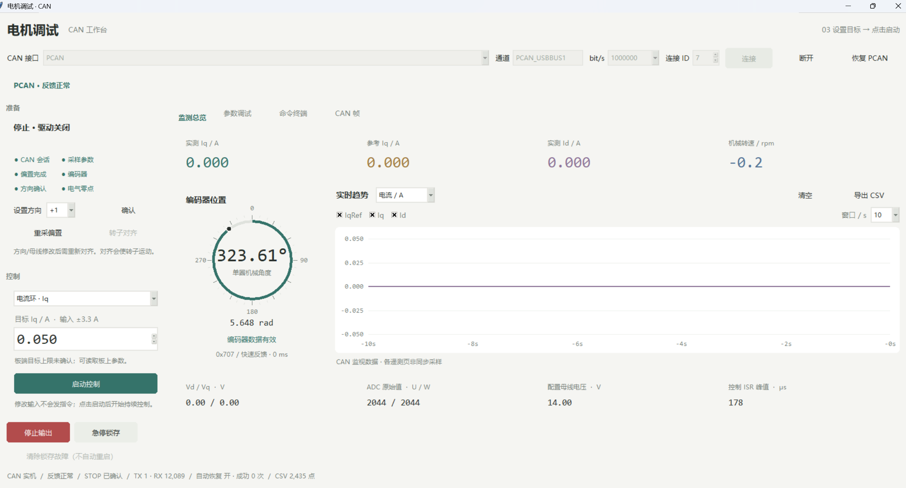
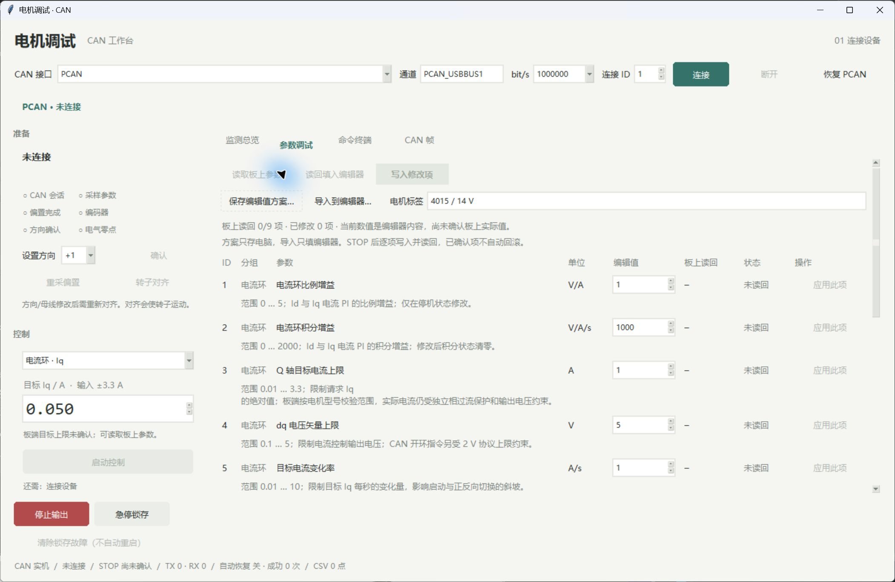

# CAN 电机调试台

## 界面预览

以下为 Windows 上位机实际窗口。监测总览已连接 PCAN / 节点 7，反馈正常，截图时为 STOP、驱动关闭；参数页截图未连接硬件，编辑器数值不是实板读回。





[下载 Windows 上位机](https://github.com/Gary-KU/vectordrive-2808/releases/latest)：完整解压后运行目录中的 EXE。下文 dist 路径用于本地源码打包。当前实测节点为 7，新板默认节点为 1。

新版采用浅色、少边框的界面：左侧按连接后的检查/校准、设置目标、启动/更新和停止排列；右侧分为监测总览、参数、终端、CAN 帧。连接后保持停机，编辑目标不会立即发出运动指令。启动按钮会显示缺少的前置条件；运行时模式锁定，目标需要显式点击“更新目标”。STOP 和急停始终可见。

Windows 新版位于 `dist/GimbalCAN-Studio/GimbalCAN-Studio.exe`，根目录 `start_can_workbench.cmd` 优先启动新版；原 `dist/GimbalCAN` 旧版保留。复制时保留整个新版文件夹。

## 编码器角度与转速

新版固件提供 `0x700+node` 快速机械角/速度/Iq，目标200Hz，界面优先使用并标出数据年龄。旧固件的 `0x580+node` 第2页角度（约33.3Hz）仍可兼容显示，状态速度约100Hz；可调ID和FAST需要烧录本轮新固件。界面显示单圈0..360°表盘、弧度和rpm，曲线可切换电流、角度、转速。角度是经固件方向设置后的单圈机械角，度数由CAN值换算，显示小数位不代表额外测量精度。FAST一旦出现，无效或超期时不会退回旧角度伪装成正常。

断开、未收到状态、编码器无效、尚无角度页，或状态/角度页超过250ms未更新时，角度显示“—”并注明原因。页面1/0的新数据不会使旧角度续期。角度显示有效期为250ms；运行时原有50ms反馈检查和固件100ms运动失联停机不变。模拟数据始终显示模拟提示。

2026-10-31 更新：停机时任一状态/诊断帧超过 250 ms 未更新也会明确报告 CAN 反馈中断并断开会话，需重新连接；运行时仍采用 50 ms 期限。顶部显示“反馈正常/反馈中断”，编码器无效与整个 CAN 断流分别提示，故障码附中文名称。`0x01080000` 表示编码器反馈异常和急停锁存，需要 STOP、清故障并重新完成转子对齐。详见 [本次现场与验证记录](CAN_ANGLE_FEEDBACK_20261031.md)。

带锁存故障时也可以连接并查看诊断、执行独立 CLEAR；STOP 应答携带故障位不会再被误判为连接失败。连接本身不清故障，未完成方向/零点等条件仍不能启动电流环。

CSV 新增 `angle_rad`、`angle_deg`、`rpm`、`angle_valid`、`angle_age_ms`；无效角度留空，不用0替代。角度页和状态页独立到达，CSV中角度可能在多条100Hz状态记录中重复，不是同步高速采样。

参数页已统一使用 [参数表](../config/parameters.json)，显示单位、范围、说明和修改状态，并支持保存/导入 JSON 方案、停机批量写入修改项。导入只填编辑器，写入逐项等待 ACK 和实际读回；详见 [调参指南](TUNING_GUIDE.md)。

双击仓库根目录 `start_can_workbench.cmd`，或打开 `dist/GimbalCAN-Studio/GimbalCAN-Studio.exe`。发布程序自带 Python/Tk 和 CAN 通讯代码，不需要另外安装 Python；复制到其他电脑时请保留整个 `GimbalCAN-Studio` 文件夹及其中的 `_internal`，不能只复制 exe。

程序启动后保持未连接。默认接口为 **PCAN**，通道为 **PCAN_USBBUS1**，波特率 **1 Mbps**、节点 **1**；点击连接后才打开适配器并执行 STOP 握手。需要电脑演示时手动选择“模拟器（不连接真实电机）”；模拟曲线不能证明实际电机的电流环稳定性、转矩或采样精度。

查看真实板子角度时选择 **PCAN / PCAN_USBBUS1 / 1000000 bit/s / 节点 1** 并连接。模拟器中的角度不会随真实磁铁变化，真实板掉电也不会让模拟器报 CAN 断线；新版会在角度旁注明“模拟角度 · 不读取板子”。

## 连接与故障恢复

PCAN 首次连接失败时，后台最多尝试 3 次，每次重新打开通道并发送 STOP；重试之间间隔 400 ms。只有收到执行 ACK 和新的停机状态/诊断反馈才视为连接成功。重连不会恢复原来的运动目标、对齐、故障清除或参数写入。

“适配器已打开但没有收到帧”与“已收到其他反馈，但没有匹配序号的 ACK”分别提示。参数已有执行 ACK 但缺少 `0x481` 读回时，明确显示“参数读回超时”，不会当成写入成功；普通 STOP 超时不再归因于旧固件参数扩展。底部 TX/RX 为本次会话提交/接收的帧数，TX 只代表提交给适配器，不代表执行成功。

新版默认在通信故障后自动恢复连接。运行时仍按 50 ms 反馈期限停止并丢弃旧命令，停止运动流至少 200 ms 后才进入恢复；先重开会话，仍无有效节点反馈时才精确重启 PCAN。恢复后只做 STOP 握手，保持停机，不恢复原运动、对齐、故障清除或参数写入。重试等待为 0.25／2／5／10 秒，设备重启至少间隔 60 秒，5 分钟内最多 3 次；持续缺电/断线时保持等待与提示。STOP、断开及关闭窗口可取消自动恢复；取消后可重新点击连接。

“恢复 PCAN”保留为显式停机维护入口。恢复期间显示阶段，运动/参数操作不进入队列。总线上其他节点仍有有效状态/诊断反馈时，不会因为所选节点缺失而重启共享 PCAN。底部 RX 包含其他节点状态/诊断，因此 RX>0 不等于当前选中节点已连通，选中节点仍需自己的 ACK 和新反馈。

设备重启入口目前支持 Windows、单台经典 PCAN-USB（`PCAN_USBBUS1`）。检测到多个设备、其他型号/通道或 Windows 权限不足时，会报告明确原因，请手动重插目标 USB-CAN 后连接。只重启匹配到的 PCAN 设备，不重启 DAPLink 或 USB 集线器。USB 设备恢复也不能修复收发器缺电、RX 持续为低等板级问题。

错误摘要最多显示三行，完整原因保留在命令终端；STOP/急停位于独立的底部操作区，不随工作区缩小而被长错误提示挤出窗口。Windows 上位机只允许打开一份，重复启动会切回已有窗口，避免多实例争用 PCAN。

2026-11-01 新版164项Python回归（含16项原生界面）、打包模拟ID迁移/参数/编码器/正负Iq自检通过；这些不等于六板实机测试。2026-10-31 的旧版基线曾在 PCAN 设备恢复后停机监测60秒、收到18,044帧，未发生反馈超时；该记录属于当时版本和现场。详见 [历史追测记录](CAN_INIT_RECOVERY_20261031.md#16411643-追测同一块板恢复通信并通过一分钟监测)。

## 功能

- 参数页“板上节点 ID · 掉电保存”可读取并修改 1..63。若板上已有匹配的电角度 Flash 校准，改 ID 重启后会自动恢复，不需要再次吸合；没有保存值时仍需在安全状态完成对齐。命令终端为 `node` / `node 3 single`。

- 参数页“电角度零点 · Flash 掉电保存”提供读取、保存和“拆板/换电机：清除保存值”。第一次在空载状态完成方向确认和 ALIGN，确认零点有效后点击保存；写入和重启后会自动读回验证。以后上电只重采 ADC 偏置并静默恢复零点。清除带二次确认，不会启动电机；终端命令为 `zero`、`zero save`、`zero clear`。

- 电流模式：上位机输入/编码范围 ±3.3 A；若已真实读回参数3，目标超过读回值时弹出“目标超过已读回的电流限幅 ±N A”并拒绝发送，未读回时由板端参数3及执行ACK决定是否接受；2808 与 4015 固件均支持请求上限3.3 A，上电默认均为1 A。主机每10 ms使用新序号发送；也支持速度模式和小电压开环。相电流保护1.5 A保持，超过即停机。
- 电流 PI、速度 PI、电流上限、矢量限压、电流斜坡、速度上限和母线换算值：读取、逐项写入、执行 ACK 与实际值读回。
- 显示 Iq、Id、Iq 参考、机械角度、转速、Vd/Vq、原始 U/W ADC，以及编码器、方向、偏置、电气零点、控制会话的状态。
- 实时电流/机械角度/转速曲线、CSV 导出、CAN 收发帧日志、命令终端。
- STOP、锁存急停 ESTOP、偏置重校准、方向设置、电气对齐、故障清除。

板端电流控制仍在 2 kHz ADC 中断运行。PC 的 100 Hz CAN 流只更新目标，PC 不参与每次电流 PI 运算。Iq 单位为 A，是 q 轴电流；要换算 Nm 还需要电机转矩常数。

## 在电脑上先验证

1. 接口选择“模拟器”，点击“连接”，等待 STOP 握手完成及偏置、编码器状态有效。
2. 点击“读取参数”，确认右侧读回值出现。停止状态下修改 Kp/Ki，点击对应行“应用”，查看执行与读回日志。
3. 在“设置方向”处选择 `+1` 并点击“确认”，再点击“转子对齐”。模拟对齐约 1.5 秒，完成后零点有效且驱动关闭；随后可在参数页保存零点并验证重启恢复。真实固件对齐约 4 秒。
4. 选择电流环，输入 `0.050` A，点击启动/更新。曲线会显示模拟电流跟随；运行中可更新为负电流。
5. 点击 STOP。观察 STOP 执行确认、驱动关闭；测试 ESTOP 后需 CLEAR，重新等待偏置并对齐。

连接、读取参数、修改输入框都不会自动启动。`align` 和启动/更新是明确的运动操作。

## 连接实机

板子必须使用带**参数扩展**的固件：`software/build/Release/gimbal_foc.hex`。当前版本已烧录并验证真实 PCAN STOP、状态/诊断/角度遥测和全部参数查询；CAN 初始化失败后的停止重试也已验证，见 [固件记录](CAN_INIT_RECOVERY_20261031.md)。这不代表外部 CAN 下的电机稳态带载试验已完成。旧固件的原有运动命令可兼容，但不支持参数读写及扩展遥测；参数请求会明确报错或超时，不会显示“已写入”。

将 USB-CAN 的 CAN_H、CAN_L、GND 接到板上对应端子。总线两端各使用 120 Ω 终端电阻，保持线序一致。默认选择 **1,000,000 bit/s、节点 1**，与固件配置一致。CAN 适配器须支持 Classic CAN 标准 11 位帧。

| 接口选项 | 通道示例 | 说明 |
|---|---|---|
| PCAN | `PCAN_USBBUS1` | Windows 需安装 PEAK 驱动和 PCAN-Basic，位数与程序一致（本包为 x64） |
| SLCAN | `COM3` | 适配器需使用 LAWICEL/SLCAN 固件；普通 USB 转串口不是 USB-CAN |
| CANalyst-II | `0` | 第一台适配器的第一通道；使用 python-can 的 canalystii 后端，需其兼容 USB 驱动 |
| SocketCAN | `can0` | 适用于 Linux 源码运行，先在操作系统配置 CAN 设备与波特率 |
| USB2CAN | 后端设备标识 | 专指 python-can 的 USB2CAN 后端，需要对应厂商驱动；不是任意标有 USB-CAN 的设备 |

不同 USB-CAN 的驱动协议不同，名称不能互换。“周立功兼容/ControlCAN.dll”也不一定等于 CANalyst-II 的 libusb 后端；按实际硬件选择。上位机不安装或替换 USB 驱动。适配器接口约定可查 [python-can 官方接口说明](https://python-can.readthedocs.io/en/stable/interfaces.html)。

接入后：连接并等待 STOP 握手 → 等待偏置/编码器正常 → 确认方向（本板历史实测为 +1）→ 转子可自由对齐时执行 ALIGN → 等待零点有效 → 从小电流开始。已锁轴的转子不能直接用于重新电气对齐。电流模式空载会持续加速，测试电流跟随与力矩时使用合适负载。

## 调参和指令

参数写入要求 **STOP、EN 关闭、无故障**。上位机和固件各自检查；每项写入必须收到执行 ACK 和相同序号的实际值读回才算成功。写入会清除 PI 积分，普通增益/限幅修改保留已验证的电气零点；修改母线换算值、方向或重校准会使旧零点失效。

| ID | 终端参数名 | 含义 / 单位 | 范围 |
|---|---|---|---|
| 1 | `current_kp` | d/q 共用 Kp，V/A | 0..5 |
| 2 | `current_ki` | d/q 共用 Ki，V/(A·s) | 0..2000 |
| 3 | `iq_limit` | 电流目标请求限幅，A | 两种型号均为0.01..3.3；默认均1 |
| 4 | `voltage_limit` | 闭环 dq 矢量限压，V | 0.1..5 |
| 5 | `iq_slew` | 电流目标斜坡，A/s | 0.01..10 |
| 6 | `speed_kp` | 速度 Kp，A/(rad/s) | 0..1 |
| 7 | `speed_ki` | 速度 Ki，A/rad | 0..10 |
| 8 | `speed_limit` | 机械速度目标限幅，rad/s | 0.1..30 |
| 9 | `bus_voltage` | 实际供电的换算值，V | 8..30，当前供电应填写 14 |

这些是输入范围，不表示范围内任意PI组合均适合当前电机。输入框下方显示板端目标上限和独立相电流保护；参数编辑值或导入方案不会提高已确认的板端额度。主机输入范围为±3.3 A；已读回参数3时，目标超过读回值会弹出“目标超过已读回的电流限幅 ±N A”并拒绝本次发送，未读回参数3时不拦截，交由板端执行ACK判断。板端对超过自身参数3的请求返回RANGE，主机显示执行拒绝并STOP，不做隐藏截断。写入未确认或重启时撤销旧缓存，界面显示待重新读取。2808 与 4015 均在参数3真实设置为3.3 A之后才会接受2 A或3.3 A请求；独立相电流保护仍为1.5 A。完整读取9项参数后会查询LIMITS_READ，旧固件不支持则显示保护信息未读回并保留原通信能力。**参数仅保存在RAM，复位或掉电恢复默认1 A**；节点ID单独掉电保存。真实3.3 A输出未获验证，见[板端范围说明](2808_REQUEST_LIMIT.md)。

命令终端通过同一 CAN 会话执行，不需要接串口：

```text
help
status
dir 1
align
iq 0.05
iq -0.05
stop
zero
zero save
get
get current_kp
set current_kp 1.0
set 2 1000
speed 1
open 20 0.8
bus 14
cal
clear
estop
```

`iq` 单位 A；`speed` 为机械 rad/s；`open` 为电角 rad/s 和 V，CAN 开环电压上限仍是 **2 V**。切换控制模式前先 STOP。运行命令会持续刷新，单次最多 **60 秒**，更新目标不会延长这一上限。停止后可重新开始一轮运行。未满足方向、零点、电流采样等条件时启动会被拒绝。

修改参数、批量读取参数先停止。终端 `status` 显示当前接收缓存，不发送运动命令；`get` 查询和参数请求均不延长固件的运动有效期。

## 停止、反馈与记录

CAN 运动目标超过 100 ms 未更新，固件停机；主机遇到 ACK 超时、状态/诊断超过 50 ms 未更新、故障或运行状态异常会停止刷新并请求 STOP。界面超过 500 ms 未服务后台线程、单次运行到 60 秒、断开和关闭窗口也会停止。STOP 未收到执行 ACK 时界面明确显示“未确认”，不会把适配器发送成功当成电机已停止。

保存文件对话框可能暂停界面心跳，因此请先停止再导出 CSV。曲线和 CSV 是 CAN 监视数据：状态约 100 Hz，三个扩展遥测页各约 33 Hz，页面可能来自不同采样时刻，不是同步 2 kHz 原始波形。CSV 保留最近 50,000 条并标注模拟/实机接口；切换连接会清空曲线，避免混看。

扩展帧与校验细节见 [CAN 协议](CAN_PROTOCOL.md)。

## 源码启动和打包

使用带 Tcl/Tk 的 Python 3.10+：

```powershell
python -m pip install -r desktop/requirements.txt
python -m desktop
```

CANalyst-II 源码运行额外安装 `python-can[canalystii]`；Windows USB2CAN 按官方后端要求安装 pywin32 与厂商 DLL。打包后仍需要适配器本机驱动。

本机工程已建立 `.venv-can`。重新打包：

```powershell
.\.venv-can\Scripts\python.exe -m pip install pyinstaller
.\desktop\build_windows.ps1
```

控制器、模拟传输、固件协议测试均使用假的 CAN/板级输入，不访问真实硬件。

打包程序还提供纯电脑自检，固定使用内置模拟器，不会打开 USB-CAN：

```powershell
Start-Process -FilePath .\dist\GimbalCAN-Studio\GimbalCAN-Studio.exe -ArgumentList '--self-test','--report','D:\CODE\Gimbal_borad\build\can-workbench-selftest.json' -Wait
```

报告 `simulation_only=true`、`passed=true` 表示模拟握手、9 项参数读回、参数写入、对齐、正反电流命令和 STOP 流程通过；它不表示实板测试已通过。
