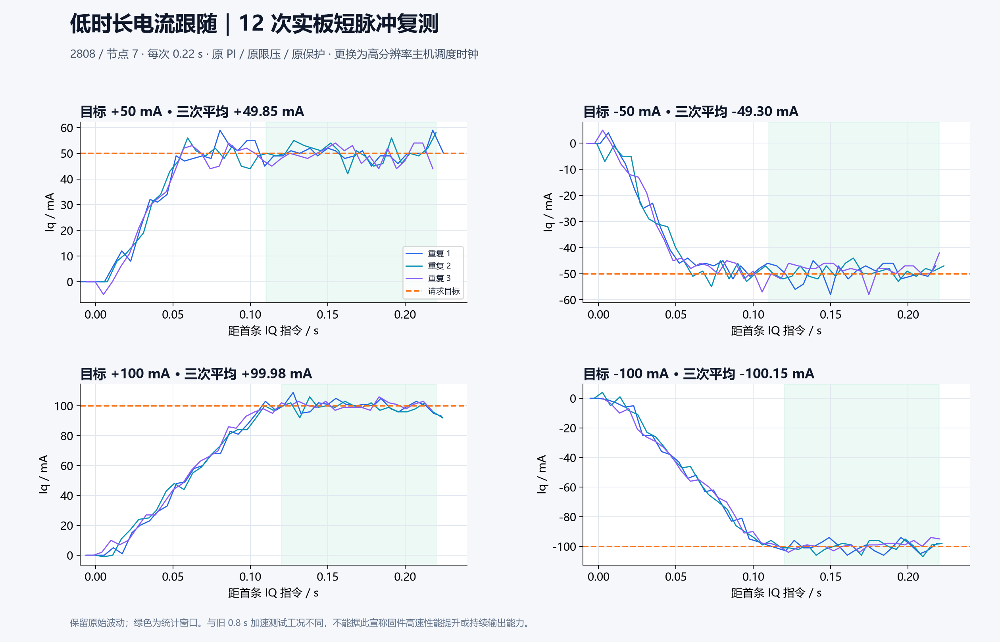
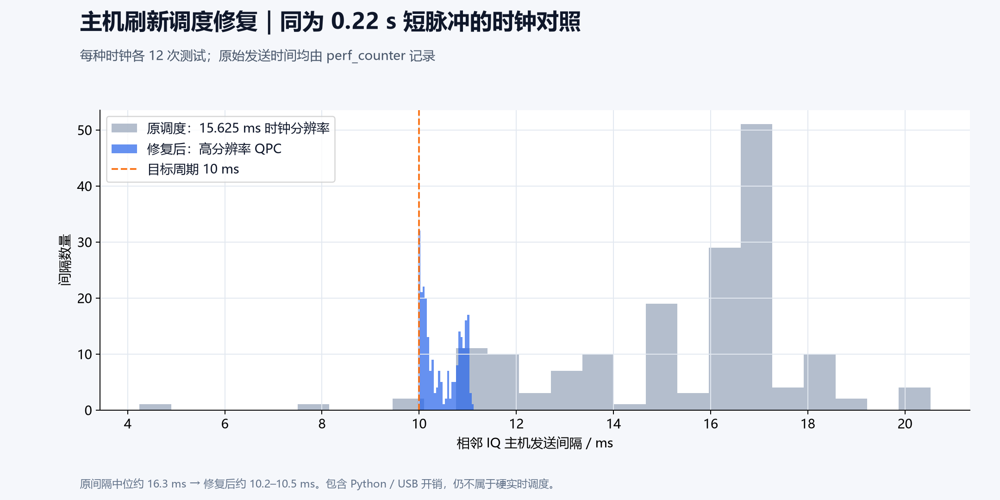

# 电流跟随排查与主机调度修复

2026-11-02，继续使用原 2808 / 7 极对 / 节点 7。用户再次确认可以转动。**没有烧录固件，没有改 PI、限压或保护阈值。** 现场电源实际电压/限流未重新确认，仍不能作为已独立测量的条件。

## 已修复的两项软件问题

1. **10 ms 命令刷新被粗时钟量化。** 此 Windows Python 3.12 的 `time.monotonic()` 使用 `GetTickCount64()`，`time.get_clock_info` 报告分辨率为 **15.625 ms**。原程序以它安排 10 ms 周期，实测发送间隔中位约 16.3 ms。改为单调高分辨率 `perf_counter()`（QueryPerformanceCounter，本环境分辨率报告为 100 ns），相同短脉冲对照中实测中位为 **10.2～10.5 ms**、各组最大间隔不超过 **11.13 ms**。这不是硬实时保证。
2. **速度报文的编码端点被当作真实转速。** 原 int16 mrad/s 格式只能表示 −32.768～+32.767 rad/s。现在端点值在上位机中视为可能饱和：保留有效角度，转速显示为不可用并提示编码边界；转速曲线/CSV 不再把边界值当作真实最高转速。没有改协议单位或固件，兼容原 CAN 帧。

CLI 的控制计时改用高分辨率时钟；上位机仅将目标刷新调度切换至该时钟，状态新鲜度和 UI 心跳继续使用原时钟，避免混用时间戳。50 ms 反馈检查、100 ms 板端运动期限、STOP 和全部板端保护保持原逻辑。

## 先区分高速限压与低时长跟随

旧 0.8 s 空载测试中，±100 mA 后半段 `|Vd|` 已达约 4 V，Vq 约 3 V；d 轴优先的 5 V 电压分配会压缩 q 轴余量。旧 FAST 角度差分也显示机械转速明显超过速度报文量程。

这些现象支持“空载加速进入限压/高转速区域”的判断，但尚未证明角度时延、交叉耦合等因素的贡献。TRACE 的 Vd/Vq 分属不同时间页，不能把它们直接合成为精确同步矢量模长，更不能将异步配对超过 5 V 当作实际超限。

此次把每个目标缩短为 **0.22 s**，减少持续加速；每组结束等待实际 STOP、驱动关闭且速度反馈低于 1 rad/s 持续 0.3 s 后，才开始下一组。±50 mA、±100 mA 各做三次，共 12 次；每次最终 STOP 均获执行 ACK。不是完全恒速或锁轴试验。

## 短脉冲复测结果



统计窗口：±50 mA 为首条目标后 110～220 ms，±100 mA 为 120～220 ms，避开 1 A/s 目标斜坡的初段。表内平均电流为三次窗口均值的平均，RMSE 为三次窗口 RMSE 的平均，不是外部电流仪器的精度认证。

| 目标 | 平均反馈 | 平均 RMSE | 每组发送间隔中位的平均 |
|---|---:|---:|---:|
| +50 mA | +49.85 mA | 3.34 mA | 10.472 ms |
| −50 mA | −49.30 mA | 2.90 mA | 10.312 ms |
| +100 mA | +99.98 mA | 3.09 mA | 10.244 ms |
| −100 mA | −100.15 mA | 3.18 mA | 10.475 ms |

**这说明原电流环在该短时工况下能够接近目标。** 与旧 0.8 s 测试持续时长、转速轨迹和统计窗口不同，不能将误差差异归因于固件改进；本次根本未改固件。

## 仅改变时钟的对照



为区分测试时长和软件修复的影响，另用原粗时钟完成同样的 12 次 0.22 s 测试。只更换调度时钟，两组均保留原生 PCAN 收发，无接收轮询补丁、无系统定时器修改、无参数写入。

| 指标 | 原粗时钟 | 高分辨率时钟 |
|---|---:|---:|
| 各组指令间隔中位数范围 | 16.275～16.522 ms | 10.244～10.475 ms |
| 最大指令间隔 | 20.527 ms | 11.126 ms |
| +100 mA 平均反馈 | +99.69 mA | +99.98 mA |
| −100 mA 平均反馈 | −99.83 mA | −100.15 mA |

两种时钟的短脉冲电流均接近目标。**时钟修复解决的是主机刷新周期问题，不是证明电流 PI 性能提高。** 缩短测试避开高速加速段，才是本次电流数据与旧长窗口明显不同的主要工况差异。

## 验证、证据与复现

- Python 回归 **215 项全部通过**，包含“粗 UI 时钟不前进时仍按高分辨率刷新”的回归，以及速度端点/量程内值的显示检查。
- 重新打包 Windows 上位机，打包版模拟自测通过；模拟结果不计入实板指标。
- 所有实板短脉冲均最终 STOP 成功，PCAN 测试连接已关闭。
- [原始记录与测试日志](performance-20261102-followup/evidence.zip)、[统计摘要](performance-20261102-followup/summary.json)。较早的系统定时器和接收轮询尝试没有解决周期问题，未纳入最终代码。

确认机械可安全自由转动后，在仓库根目录执行：

```powershell
.\.venv-can\Scripts\python.exe tools/diagnose_current.py --node 7 --output build/current-diagnosis-highres.json
# 对照：仅使用原时钟，会实际执行同样的短脉冲
.\.venv-can\Scripts\python.exe tools/diagnose_current.py --node 7 --legacy-clock --output build/current-diagnosis-legacy.json
# 从归档证据重画图，不连接硬件
.\.venv-can\Scripts\python.exe tools/plot_current_diagnosis.py
```

## 尚未解决的范围

高速情况下的相位延迟、电压余量和电流跟随还需要在可控负载/转速条件下进一步辨识；5 V 限压与硬件供电余量不能靠调整主机时钟消除。速度显示现在能识别编码边界，但还没有新增宽量程速度帧。本次也未解决累计 TX_LOSS 的来源分类或完成持续输出、带载转矩与温升测试。

下一步应先确认实际电源条件，在可控负载下记录同步电压、电流及未饱和转速，再决定是否需要角度延迟补偿、PI 调整或硬件变化。现阶段不通过提高限压、提高过流阈值或人为平滑曲线来掩盖问题。
