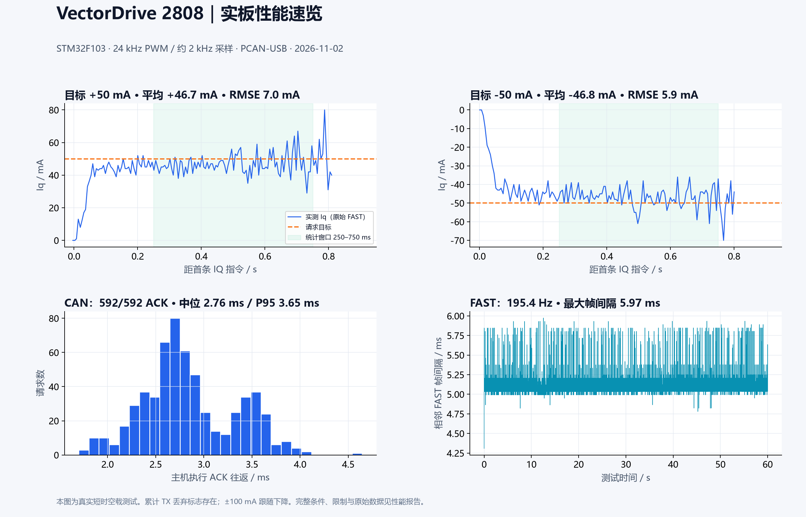
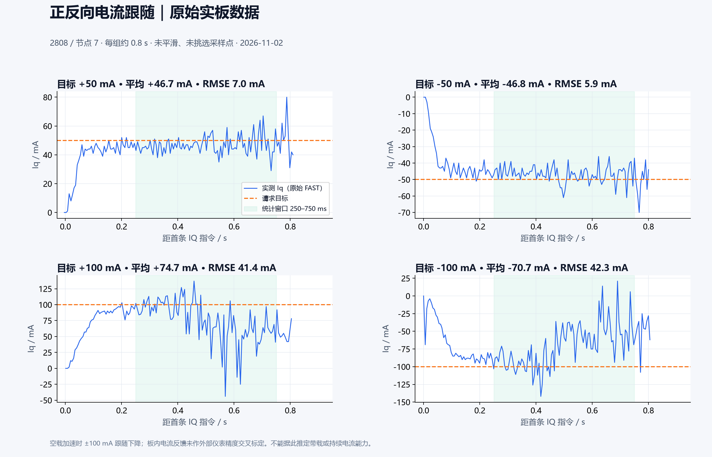
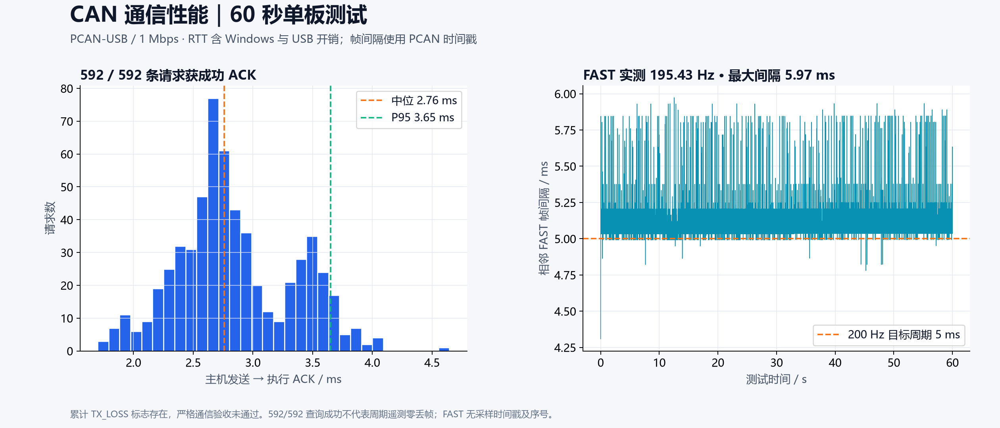
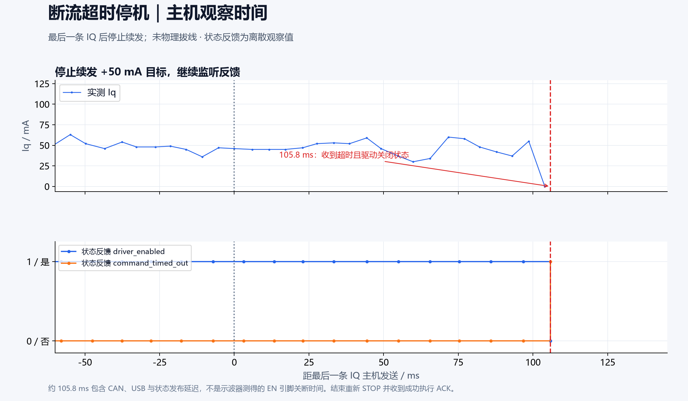

# VectorDrive 2808 实板性能测试

> 后续已补充 [短脉冲排查与主机时钟修复](CURRENT_DIAGNOSIS_20261102.md)：原 PI 下 ±100 mA 短脉冲跟随接近目标；下文保留首次 0.8 s 加速测试原始结论。

测试日期：2026-11-02，Asia/Shanghai。对象为用户确认的 2808 电机、7 极对、CAN 节点 **7**。DAPLink / CMSIS-DAP 和 PCAN-USB 均实际接入。下面数值来自本次实板运行，植物模型测试单列。

## 实测曲线

以下图片直接由归档原始帧绘制，未做平滑、插值补点或删去异常值。蓝线为实际反馈，橙色虚线为请求目标；浅绿色区间对应报告统计窗口。









图片提供 PNG 与同名 SVG。使用 `python -m pip install matplotlib` 后，在仓库根目录执行 `python tools/plot_benchmark.py` 即可从证据压缩包重新生成；本脚本不连接或控制硬件。Windows 自动使用微软雅黑字体，其他系统需安装相应中文字体。

## 可用于介绍项目的实测亮点

> VectorDrive 2808 在 STM32F103 Cortex-M3 上实现 24 kHz PWM、约 2 kHz 同步采样，并通过 1 Mbps CAN 提供约 195 Hz 快速机械反馈。60 秒实板通信测试中，592 条停机/只读请求全部获得成功执行 ACK，主机往返延迟中位数 2.76 ms、P95 3.65 ms。空载 ±50 mA 短时电流测试的平均反馈为 +46.7 / −46.8 mA；停止续发目标后，约 105.8 ms 观察到超时停机状态。

这些数据证明本次单板、短时工况的通信与小电流控制表现。累计发送丢弃标志存在，严格通信验收未通过；不能宣传“零丢包”、200 Hz 精确反馈、3.3 A 连续输出或已经完成带载性能验证。

## 测试条件与固件身份

| 项目 | 条件 / 证据 |
|---|---|
| MCU | DAPLink 识别 Cortex-M3 r1p1，CPUID `0x411FC231` |
| 固件 | Flash 前 41460 字节与本地 `gimbal_foc_2808.bin` 逐字节相同 |
| 固件 SHA-256 | `963b311060731a1910eb696b66562a6c705b68f98c2ff94da600f743c72365d9` |
| CAN | PCAN_USBBUS1，Classic CAN 标准帧，1 Mbps，节点 7，持久节点读回为 7 |
| 机械条件 | 用户确认 2808 可以自由转动；空载短时测试，无转矩计或测功机 |
| 电源 | 沿用现场供电；本次未独立测量电压、限流、电功率或温度 |
| 校准 | 运行时方向/电零点有效；Flash 校准读回未保存；未执行对齐或写 Flash |
| 保护读回 | 请求编码上限 3.3 A，相电流保护 2.0 A；两者都不代表持续输出能力 |

本次没有重新烧录、复位或调整 PI、限压、斜坡、保护阈值。README 的历史 1.5 A 保护描述与这次在线固件读回不同，复现时必须以当前固件和在线读回为准。

## 60 秒 CAN 通信测试

STOP 握手后，以约 10 次/秒轮询全部九项参数、节点、保护及校准信息。结束发送 STOP。持续约 **60.082 s**。

| 指标 | 实测 |
|---|---:|
| 已关联执行 ACK | 592 / 592，结果均 OK |
| ACK 往返最小 / 中位 / P95 / 最大 | 1.700 / 2.761 / 3.651 / 4.645 ms |
| FAST | 11727 帧，195.427 Hz，最大相邻间隔 5.973 ms |
| STATUS | 6002 帧，100.026 Hz，最大相邻间隔 10.841 ms |
| DIAGNOSTIC | 5980 帧，99.667 Hz，最大相邻间隔 20.614 ms |
| TRACE（合计三页） | 6003 帧，100.043 Hz，最大相邻间隔 10.794 ms |
| 参数响应 | 443 帧 |
| 节点 / 保护 / 校准响应 | 各 49 帧 |

RTT 使用主机 `perf_counter`，包含 Windows、USB、适配器和应用执行开销，不能当作 MCU 控制计算耗时。周期统计使用 PCAN 帧时间戳；FAST 没有板端采样时间戳和帧序号，不能据此证明采样同步或计算精确丢帧率。

**验收异常：** 全部诊断帧均带累计 `TX_LOSS` 标志，脚本严格结果为 `passed=false`，原样保留。源代码在软件回复过期、发送失败或最新值覆盖等情况下累计 `statistics.tx_dropped`，只要非零即置位，STOP 不清除此累计标志。因此可以确认标志存在，不能凭该位确定本窗口新增丢弃数。初始诊断还有 REQUIRE_STOP，随后握手解除。窗口内没有观察到应用故障、BSP 低八位故障、bus-off、error-passive 或 RX_LOSS。

后续若要完成“无新增丢弃”验收，应在同一持续连接窗口读取协议与硬件累计计数的前后差值，区分遥测合并、回复过期与物理发送失败。不能把 592/592 查询成功改写成全部遥测无丢失。

## 正反向小电流跟随

每组目标持续约 0.8 s，组间 STOP 后等待 0.5 s；复用有效校准。每组均发出 52 条新序号 IQ 指令，并收到最终 STOP 成功 ACK。统计每组首条目标后 **250～750 ms** 内的、驱动有效 FAST 数据。

| 目标 Iq | 样本数 | 平均反馈 Iq | 跟随 RMSE | 最终 STOP ACK RTT |
|---|---:|---:|---:|---:|
| +50 mA | 90 | +46.70 mA | 6.98 mA | 2.337 ms |
| −50 mA | 88 | −46.80 mA | 5.91 mA | 2.616 ms |
| +100 mA | 89 | +74.66 mA | 41.38 mA | 2.360 ms |
| −100 mA | 89 | −70.74 mA | 42.31 mA | 3.283 ms |

±50 mA 两方向平均误差约 3.3 / 3.2 mA。该反馈来自板上采样与变换，未用外部电流仪器交叉标定，不是绝对电流准确度认证。

±100 mA 空载加速时跟随明显下降，且机械速度字段到达 ±32.767/32.768 rad/s 的 int16 编码边界；不能把该边界值当成真实最高转速。可能涉及反电动势/限压，尚未通过完整电压与速度记录确认。此工况不支持宣称 ±100 mA 全窗口精确跟随，更不支持外推到 1 A 或 3.3 A。

主机目标发送间隔中位约 16.1～16.5 ms、最大约 20.6 ms，低于程序名义 100 Hz。这是本次 Windows/USB 主机调度的实测限制；板内 2 kHz 控制不依赖每拍主机指令。未通过放宽期限或保护掩盖该限制。

## 断流超时停机

第五组使用 +50 mA，停止续发 IQ，但保持 CAN 接收。距最后一条 IQ 的主机发送时刻 **105.792 ms**，收到 `command_timed_out=1` 且 `driver_enabled=0` 的状态帧；之后重新 STOP，执行 ACK RTT 为 2.243 ms。

这与固件 100 ms 运动期限及约 10 ms 状态上报量级一致。105.792 ms 包含传输和状态发布延迟，是“主机观察到关闭”的时间；没有示波器证据，不能将其解释为 EN 引脚精确关断时刻。未测试物理拔线、强制 bus-off、急停输入或故意过流。

## DAPLink 时序核对

通过运行中 SWD 读寄存器和 RAM，未暂停/复位 CPU。代码与 Flash 比对后才使用符号地址。

| 项目 | 读回 / 结果 |
|---|---|
| TIM2 PSC / ARR | 0 / 1500，按 72 MHz 中心对齐计算 PWM 24 kHz |
| TIM3 PSC / ARR | 0 / 11，每 12 个 PWM 周期触发采样，名义 2 kHz |
| 运行窗口 ADC 序号增量 | 10015 |
| 运行窗口 millis 增量 | 5008 ms |
| 估计采样率 | 约 1999.8 Hz，顺序读取带来少量端点误差 |
| 累计 ADC ISR C 路径峰值 | 20384 CPU 周期，按 72 MHz 约 283.1 µs |
| 累计 pending / elapsed-overrun / sync-error | 0 / 0 / 0，两次读取均为零 |
| 最终 GPIOA ODR | `0xB000`，PA4 驱动 EN 为低 |

ISR 峰值是自本轮上电以来的累计值，并未清零；不能归因于单一测试组。它约为 500 µs 周期的 56.6%，只覆盖软件 C 路径，未包含完整异常入退栈等开销。运行中多字段读数非原子快照，不能作为所有工况的硬实时上界证明。适配器关闭后再读 CAN ESR 可能看到无人 ACK 的发送错误，因此时序日志中的该读数不用于证明测试连接期的总线错误率。

## 软件回归

- `tests/run_tests.ps1`：退出码 0；FOC、参数、节点/校准存储断电与 CRC、应用联锁、CAN 协议与完整栈、启动对齐等 C 主机回归通过。其默认 Python 环境运行 212 项、跳过 22 项 Tk 界面测试。
- 随后用项目 `.venv-can` 单独执行 `python -m unittest discover -s tests`：**212 项全部通过，无跳过**。
- R/L 与 PMSM 植物模型结果属于软件回归，未混入上述实板电流性能表。

## 复现和原始证据

关闭其他 CAN 主站后，在仓库根目录执行：

```powershell
.\.venv-can\Scripts\python.exe tools/benchmark_board.py --node 7 --seconds 60 --output build/performance-20261102/can.json
# 明确确认机械可以自由转动后执行；会发送正反向小电流
.\.venv-can\Scripts\python.exe tools/benchmark_current.py 7 build/performance-20261102/current.json
.\.venv-can\Scripts\python.exe tools/summarize_benchmark.py build/performance-20261102
# probe 脚本 RAM 地址仅适用于本文已核对的 ELF；换固件必须先更新地址
openocd -f tools/benchmark_probe.cfg
```

首次执行 probe 前须建立输出目录。完整帧、每次请求延迟、短时控制记录、SWD 日志与回归日志归档在 [原始证据压缩包](performance-20261102/evidence.zip)，统计摘要见 [电流统计 JSON](performance-20261102/current-summary.json)。本次停止后保持 EN 低，OpenOCD 与 PCAN 测试连接均已关闭。

后续优先补充：稳定负载下的电流阶跃与限压记录、外部电流精度交叉校验、速度字段量程扩展、持续电流/温升、转矩常数与效率，以及六节点真实总线并发。当前没有这些项目的实测结论。
