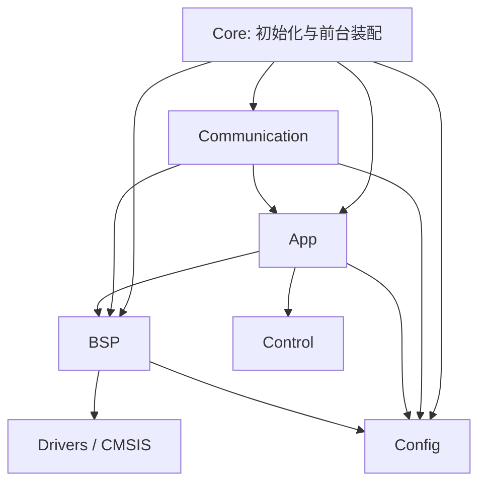

# 工程结构与维护入口

当前调参入口是 [config/parameters.json](../config/parameters.json)，执行根目录 `configure.ps1` 同步 C/Python 定义。新增独立 `foc_parameters` 配置模块及 `desktop/commands.py`、`profiles.py`；配置按电机/时序保护、采样标定和调试开关拆分，完整修改入口与操作流程见 [调参指南](TUNING_GUIDE.md)。

这是面向 STM32F103C8T6 的 **CMSIS 直接寄存器工程**。目录采用 STM32 项目常见的 `Core / Drivers / MDK-ARM` 习惯，便于用 GCC 或 Keil 打开维护；它不是 CubeMX 生成的 HAL 工程，没有 `.ioc` 文件，也没有引入 RTOS。控制、采样与通信代码保留当前实现及行为。

## 目录职责

```text
Gimbal_borad/
├─ build.ps1                       构建主入口
├─ configure.ps1                   同步/检查共享参数生成物
├─ README.md                       接线、调试和控制说明
├─ config/parameters.json           运行参数默认值、范围、单位的唯一维护源
├─ config/profiles/                 可导入上位机的参数方案示例
├─ tools/generate_parameters.py     标准库参数生成器，支持 --check
├─ software/
│  ├─ project.psd1                  GCC/Keil/测试共用布局清单
│  ├─ build.ps1                     兼容的固件构建入口
│  ├─ Config/
│  │  ├─ board_config.h             板级时钟/PWM/duty 常量
│  │  ├─ motor_config.h             配置兼容入口
│  │  ├─ motor_setup.h              电机、控制时序和固定保护
│  │  ├─ motor_profile.h            2808/7 极对、4015/11 极对编译选项
│  │  ├─ current_sense_config.h      ADC 与两相采样标定
│  │  ├─ bringup_config.h           专用调试镜像的开关
│  │  ├─ motor_tuning_defaults.h    自动生成的九项调参默认值
│  │  ├─ parameter_catalog.def      自动生成的字段映射与范围
│  │  └─ can_config.h               CAN 节点、速率、ID 和期限
│  ├─ Core/
│  │  ├─ Src/main.c                 初始化和前台循环装配
│  │  ├─ Src/system_stm32f1xx.c      CMSIS 系统初始化
│  │  ├─ Startup/                   GCC/ARMCC 启动汇编和向量表
│  │  └─ Linker/                    GCC .ld / ARMCC .sct 内存布局
│  ├─ App/Inc + Src/                app.h/c 状态机与控制权、校准、保护
│  ├─ Communication/Inc + Src/      console、can_protocol、can_service
│  ├─ BSP/Inc + Src/                board.h/c、board_can.h/c
│  ├─ Control/Inc + Src/            foc.h/c 控制核心、foc_parameters.h/c 参数表服务
│  ├─ Drivers/CMSIS/                Cortex-M3/STM32F1 设备支持
│  ├─ MDK-ARM/                     Keil 工程、同步脚本及 Keil 产物
│  └─ build/                       GCC 构建产物
├─ tests/                          控制仿真、协议和应用集成测试
├─ desktop/                        CAN 调试台、命令解析、方案、会话与传输分层
├─ examples/parameter_catalog.py    自动生成，供 PC 各模块共用的参数定义
├─ examples/gimbal_can.py           只生成 CAN 帧和解码反馈的主机辅助工具
└─ docs/                           首跑、CAN 协议与工程维护文档
```

`Core` 负责把各模块接起来，不承载电流 PI 或通信报文定义。启动汇编与链接文件分别为两个工具链提供向量表、复位入口和 64 KiB Flash / 20 KiB RAM 布局。

`App` 决定何时可以运动：偏置采集、方向/电气零点确认、开环首跑、模式与控制源联锁、命令期限及故障停机。ADC 回调仍是快速控制入口，前台轮询维护编码器与命令来源。

`Communication` 负责 UART 文本和 CAN 报文。它校验输入、序号、新鲜度和执行确认，再通过 `App` 的命令 API 提交目标；CAN ISR 只接收/排队报文，UART ISR 只搬运字节。

`can_service` 管理 CAN 外设与协议生命周期。初始化失败后仅在 App 允许的停止状态下按 500 ms 间隔重试，成功后重新要求 STOP 握手；协议报文保持在 `can_protocol`，寄存器操作保持在 `board_can`。实板验证见 [CAN 自动恢复记录](CAN_INIT_RECOVERY_20261031.md)。

`BSP` 负责寄存器和实际引脚：时钟、TIM2、双 ADC、AS5600、UART、按键/LED、看门狗以及 bxCAN。`Control` 只实现坐标变换、Id/Iq PI、速度 PI、斜坡和 SVPWM，不直接访问外设。

## 依赖方向



`Config` 只提供常量，不包含 BSP 外设 API。`motor_config.h` 通过 `board_config.h` 获取板级频率常量，不再为了这些常量包含整个 `board.h`。`Control` 接受调用者传入的 `FocConfig`，因此主机仿真无需 STM32 外设。测试使用 BSP stub，并按各测试需要链接实际 `App / Communication / Control` 源码。

## 修改参数的位置

| 修改内容 | 文件 | 同时需要核对 |
| --- | --- | --- |
| PWM 频率、周期和允许 duty 窗口 | `software/Config/board_config.h` | BSP 时钟寄存器、低侧 ADC 触发窗口、完整 ISR 预算 |
| 极对数、母线换算值、开环/对齐电压、首跑等待 | `software/Config/motor_config.h` | 实际电机/供电与首跑步骤 |
| U/W 分流电阻、增益、极性、采样确认开关 | `software/Config/motor_config.h` | 实物/BOM 与已知小电流校验；偏置校准不能代替比例确认 |
| 电流/速度 PI、限幅、控制频率与速度分频 | `software/Config/motor_config.h` | 电机参数、频率整除关系、实板时序和稳定性 |
| CAN 节点、波特率、ID、反馈周期和命令期限 | `software/Config/can_config.h` | 上位机配置与 [CAN 协议](CAN_PROTOCOL.md) |
| 引脚、外设初始化或 ADC 同步采样 | `software/BSP/Src/board.c`、`board_can.c` | 本板原理图及外设时序 |
| 模式、校准、控制权与故障策略 | `software/App/Src/app.c` | 应用/协议集成测试 |
| 串口命令或 CAN 逐字节协议 | `software/Communication/Src/` | 协议文档、测试和上位机辅助工具 |
| 纯控制算法 | `software/Control/Src/foc.c` | 主机仿真和实际环路整定 |

板级配置文件中的数值描述当前硬件设计；修改时钟常量不会自动重写 PLL 或分频寄存器。当前为 72 MHz 内核、24 kHz PWM、2 kHz 同步 ADC与FOC、1 kHz 速度 PI。TIM3 在内部对 TIM2 TRGO 作十二分频，采样仍锁定 PWM 的低侧窗口；应用和测试按 ADC 频率计时。本板10mΩ/50倍及两路映射和极性已实测确认，电流闭环结果见 [CURRENT_LOOP_BRINGUP.md](CURRENT_LOOP_BRINGUP.md)。

## 统一清单与新增文件

`software/project.psd1` 中的路径都相对 `software/`：

| 字段 | 用途 |
| --- | --- |
| `IncludeDirectories` | 配置、模块 API 和 CMSIS 包含目录 |
| `SourceGroups` | Core、App、Communication、BSP、Control 的名称与源码目录；`Roles` 将 App、Console、Foc 等测试角色映射到组内文件 |
| `HeaderGroups` | Config 等需要在 IDE 显示的头文件组 |
| `Startup.Gcc / Armcc` | 两个工具链各自的启动汇编 |
| `Linker.Gcc / Armcc` | GCC LD 和 ARMCC SCT 文件 |

已有模块的 `Src` 目录会由构建/同步脚本收集 C 文件。新增整个模块时，在这里登记源码分组和包含目录，再运行：

```powershell
.\software\MDK-ARM\update_project.ps1
```

同步脚本从清单更新 Keil 的分组和包含路径；测试脚本也读取同一清单定位模块，避免为目录布局维护第二份列表。主机测试仍按用例选取实际源文件和 stub，不链接 MCU 的启动汇编或板级寄存器实现。

## 构建与产物

在仓库根目录运行：

```powershell
.\build.ps1 -Configuration Release -Test
.\build.ps1 -Configuration Debug
.\build.ps1 -Configuration OpenLoopTest
# 编译器未在 PATH 时，追加 -Toolchain '实际 arm-none-eabi bin 目录'
```

旧 `.\software\build.ps1` 接受相同参数并继续可用。源文件移动不改变产物路径：

| 构建/工具 | 主要产物 |
| --- | --- |
| GCC Release | `software/build/Release/gimbal_foc.elf/.hex/.bin/.map` |
| GCC Debug | `software/build/Debug/gimbal_foc.elf/.hex/.bin/.map` |
| GCC OpenLoopTest | `software/build/OpenLoopTest/gimbal_foc.elf/.hex/.bin/.map` |
| Keil GimbalFOC | `software/MDK-ARM/Objects/gimbal_foc.axf/.hex` |
| Keil OpenLoopTest | `software/MDK-ARM/ObjectsOpenLoopTest/gimbal_foc.axf/.hex` |

Keil 仍打开 `software/MDK-ARM/GimbalFOC.uvprojx`，保留 **GimbalFOC / OpenLoopTest** 两个目标。Release、Debug 和 GimbalFOC 普通目标保持上电停机；只有 OpenLoopTest 专用构建启用供电复位后的单次自动开环。具体行为见 [无按键首跑说明](OPEN_LOOP_FIRST_RUN.md)。

运行主机测试可使用 `.\tests\run_tests.ps1`。交叉编译、Keil 构建、内存占用和已完成检查见 [构建验证记录](../software/BUILD_VERIFICATION.md)。构建/仿真成功不代表已经完成实板运行验证。
